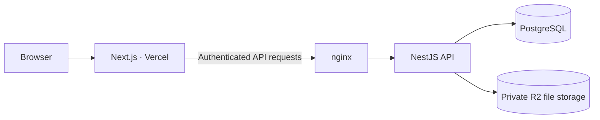

# OSS Hub

[한국어](README.md) | **English**

**A web service connecting students' open-source activities with programs run by faculty and staff.**

OSS Hub brings program discovery, team formation, applications, document submission and review, and GitHub repositories and activity together in one place.

[Visit OSS Hub](https://jnu-oss-hub.com) · [Developer onboarding](docs/onboarding.en.md) · [Issues](https://github.com/JNU-SWCU/oss-hub/issues) · [Releases](https://github.com/JNU-SWCU/oss-hub/releases)

The application interface and screenshots are currently in Korean.
The guides linked below are available in English; links marked “(Korean)” in those guides lead to documents without an English version.

## Contents

- [Features](#features)
- [User roles and participation workflow](#user-roles-and-participation-workflow)
- [Screenshots](#screenshots)
- [Technology](#technology)
- [Getting started locally](#getting-started-locally)
- [Repository structure](#repository-structure)
- [Development and verification](#development-and-verification)
- [Documentation guide](#documentation-guide)

## Features

| Feature                                     | What you can do                                                                                                                                            |
| ------------------------------------------- | ---------------------------------------------------------------------------------------------------------------------------------------------------------- |
| Program discovery and applications          | Check program schedules and participation requirements, and prepare an application.                                                                        |
| Team formation and participation            | Invite teammates, check participation status, and apply as a team.                                                                                         |
| Document submission                         | Check the deadline, days remaining (D-day), and submission status for each submission item, such as a project plan or final deliverable, and submit files. |
| Application decisions and submission review | Approve or reject applications, view submission summaries by document type and team, and review submissions.                                               |
| GitHub integration                          | Sign in with GitHub, connect repositories, and view activity.                                                                                              |
| Sharing and communication                   | Explore activities and updates through the public archive, rankings, discussion boards, and notifications.                                                 |

## User roles and participation workflow

| Role                          | Main capabilities                                                                                                                     |
| ----------------------------- | ------------------------------------------------------------------------------------------------------------------------------------- |
| **Student · STUDENT**         | Apply to programs, join teams, submit and resubmit documents for approved applications, and view their own repositories and activity. |
| **Faculty and staff · STAFF** | Manage programs, approve or reject applications, review submissions, and request revisions.                                           |
| **Administrator · ADMIN**     | Manage programs, plus users, permissions, audit logs, and system administration.                                                      |

Membership type and operational permissions are managed separately, and one account can have multiple permissions.
Faculty and staff handle application decisions; administrators with the relevant operational permissions can also make these decisions.
Neither faculty and staff nor administrators can decide on applications or review submissions from a team they belong to.

A typical participation workflow is:

1. **Explore** — Check the application period, program schedule, and submission items.
2. **Prepare and apply** — Form a team, fill in the required application information, and submit it.
3. **Application decision** — Faculty and staff review the application and approve or reject it.
4. **Participate, submit, and review** — Approved teams submit documents and make revisions based on review feedback.

Application approval and the review outcome for each submission are managed separately.
A project plan and a final deliverable are separate submission items, so their names, deadlines, and submission statuses remain distinct even when they share a due date.

## Screenshots

These examples were captured using synthetic accounts and programs, not real user data.
They show the interface at the time of capture and may differ from the current service.

### Individual document deadlines and days remaining

View the deadline, days remaining, and submission status separately for the project plan and final deliverable.
The Korean interface labels the countdown as D-day, for example D-9 for nine days remaining.


<details>
<summary>View application preparation and teammate invitations</summary>

Fill in application information and invite teammates.


</details>

<details>
<summary>View the submission summary for faculty and staff</summary>

View submission status by document type and find items to review.


</details>

## Technology

| Area                           | Technologies                                                                |
| ------------------------------ | --------------------------------------------------------------------------- |
| Frontend                       | Next.js App Router, React, TypeScript, Tailwind CSS, Radix UI               |
| Backend                        | NestJS, TypeScript, Prisma                                                  |
| Data and files                 | PostgreSQL, private Cloudflare R2 file storage                              |
| Authentication and integration | GitHub OAuth, GitHub repository and activity collection                     |
| Verification                   | Vitest, Jest, Playwright with Chrome, GitHub Actions                        |
| Deployment                     | Vercel for the frontend; Docker Compose, nginx, and Jenkins for the backend |

The main request flow in production is:



The browser uses `/api/v1` on the same domain as the frontend, and the backend handles access to the database and file storage.
See the [system architecture](docs/architecture.en.md) and [architecture decision records](docs/decisions/README.en.md) for detailed boundaries and deployment arrangements.

## Getting started locally

### Prerequisites

- Node.js **24 or later**
- pnpm **11.0.0** — specified by the repository's `packageManager` field
- Docker and Docker Compose
- direnv — integrated with your shell

### 1. Set up the repository and dependencies

```bash
git clone https://github.com/JNU-SWCU/oss-hub.git
cd oss-hub
corepack enable
pnpm install
cp .envrc.example .envrc
```

`pnpm install` also generates the backend's Prisma Client.

### 2. Configure the local environment

Follow the instructions in `.envrc` to generate and enter **two different signing keys** (`SESSION_SECRET` and `TEAM_JOIN_CODE_SECRET`).
To use GitHub sign-in, also enter the Client ID and Client Secret of a development OAuth App.
The example OAuth values are placeholders and cannot be used to sign in.

The OAuth App's local callback URL must match:

```text
http://localhost:3000/api/v1/auth/github/callback
```

Once configured, load the settings into your shell:

```bash
direnv allow
```

See the [local development guide](docs/rules/local-dev.en.md) and [onboarding guide](docs/onboarding.en.md) for GitHub App integration and test accounts with different roles.
Configure roles for test accounts in `AUTH_INITIAL_ROLES` in `.envrc` before their first sign-in.
Do not commit `.envrc` or private key files to Git.
Use `.envrc.example` as the starting point for local configuration; `.env.example` lists the environment variables required by the production Compose setup.

### 3. Start development

```bash
pnpm dev
```

Open [http://localhost:3000](http://localhost:3000).
This command checks required settings and ports `3000` and `4000`, starts the development infrastructure, applies existing migrations, and then starts the frontend and backend.
The applications run on the host with hot reload; Docker runs the development PostgreSQL database and file storage.
`compose.yml` is for production; local development uses `compose.dev.yml`.

### 4. Stop development

After stopping the applications with `Ctrl+C`, stop the development infrastructure if you no longer need it:
Your saved development data is retained.

```bash
docker compose -f compose.dev.yml stop
```

## Repository structure

```text
apps/
├── frontend/            # Next.js UI, features, and browser tests
└── backend/             # NestJS API, business rules, and background jobs
    └── prisma/          # Data model and migrations
docs/
├── decisions/           # Technical and operational decisions
├── rules/               # Development, security, and verification rules
└── deploy/              # Deployment and operations guides
scripts/                 # Development, verification, and deployment helpers
skills/                  # Repository-specific agent workflows
deploy/                  # nginx and Jenkins configuration
.github/workflows/       # CI
compose.dev.yml          # Local development infrastructure
compose.yml              # Production runtime
```

## Development and verification

Run these commands from the repository root.
Choose the checks required for your changes using the [CI verification rules by path](docs/rules/ci-path-verification.en.md).

| Purpose                                   | Command                                  |
| ----------------------------------------- | ---------------------------------------- |
| Check code and structure                  | `pnpm lint`                              |
| Check types                               | `pnpm typecheck`                         |
| Run frontend tests and backend unit tests | `pnpm test`                              |
| Build all applications                    | `pnpm build`                             |
| Check formatting                          | `pnpm format:check`                      |
| Run backend database integration tests    | `pnpm --filter backend test:integration` |
| Run browser tests                         | `pnpm --filter frontend e2e`             |
| Create a development migration            | `pnpm db:migrate:dev`                    |

`pnpm test` does not include backend database integration tests or browser tests.
Database integration tests use a dedicated isolated runner, and browser tests use installed Chrome with a separate test environment.
Use `pnpm --filter frontend e2e:install` to install the browser, and consult the verification rules for detailed requirements.

Keep changes within the issue's scope and acceptance criteria, and record the verification you actually performed in the PR.
Before contributing, read the [onboarding guide](docs/onboarding.en.md), [PR scope and submission rules](docs/rules/pr-scope.en.md), and [security rules](docs/rules/security.en.md).

## Documentation guide

| Topic                                             | Document                                                    |
| ------------------------------------------------- | ----------------------------------------------------------- |
| Joining the team and starting your first task     | [Onboarding](docs/onboarding.en.md)                            |
| Environment setup, sign-in, and local development | [Local development](docs/rules/local-dev.en.md)                |
| System boundaries and request flow                | [Architecture](docs/architecture.en.md)                        |
| Reasons behind technical decisions                | [ADR index](docs/decisions/README.en.md)                       |
| Tests required for each changed path              | [CI verification rules](docs/rules/ci-path-verification.en.md) |
| Writing and reviewing PRs                         | [PR scope and submission rules](docs/rules/pr-scope.en.md)     |
| Public repository safety and data protection      | [Security rules](docs/rules/security.en.md)                    |
| Pre-deployment checks                             | [Deployment verification](docs/deploy/pre-deploy-verify.en.md) |
| Working guidelines for agents                     | [AGENTS.md](AGENTS.en.md)                                      |

See [GitHub Issues](https://github.com/JNU-SWCU/oss-hub/issues) for the latest status of improvements and known issues.
