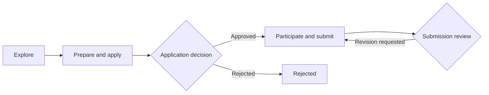
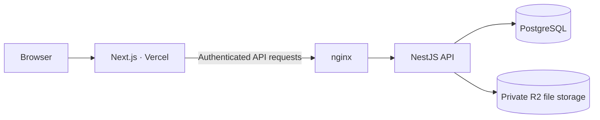

<p align="center">
  <a href="https://jnu-oss-hub.com">
    
  </a>
</p>

<h3 align="center">A web service connecting students' open-source activities with programs run by faculty and staff</h3>

<p align="center">OSS Hub brings program discovery, team formation, applications, document submission and review, and GitHub repositories and activity together in one place.</p>

<p align="center">
  <a href="README.md">한국어</a> · <b>English</b>
</p>

<p align="center">
  <a href="https://github.com/JNU-SWCU/oss-hub/releases"></a>
  <a href="https://github.com/JNU-SWCU/oss-hub/actions/workflows/ci.yml"></a>
  <a href="https://jnu-oss-hub.com"></a>
  <br>
  
  
  
  
  
</p>

<p align="center">
  <a href="https://jnu-oss-hub.com"><b>Visit OSS Hub</b></a> •
  <a href="#features">Features</a> •
  <a href="#screenshots">Screenshots</a> •
  <a href="#participation-workflow">Workflow</a> •
  <a href="#getting-started-locally">Getting started</a> •
  <a href="#technology">Technology</a> •
  <a href="#contributing">Contributing</a>
</p>

---

> [!NOTE]
> The application interface and screenshots are currently in Korean. English reading references are available for the retained skills and templates. Each translation links back to its authoritative Korean source.

## Features

- 🧭 **Program discovery and applications.** Check program schedules and participation requirements, and prepare an application.
- 👥 **Team formation and participation.** Invite teammates, check participation status, and apply as a team.
- 📄 **Document submission.** Check the deadline, days remaining (D-day), and submission status for each submission item, such as a project plan or final deliverable, and submit files.
- ✅ **Application decisions and submission review.** Approve or reject applications, view submission summaries by document type and team, and review submissions.
- 🐙 **GitHub integration.** Sign in with GitHub, connect repositories, and view activity.
- 🏆 **Sharing and communication.** Explore activities and updates through finished programs and public projects, rankings, discussion boards, and notifications.

## Screenshots

> [!NOTE]
> These examples were captured using synthetic accounts and programs, not real user data. They show the interface at the time of capture and may differ from the current service.

<table>
  <tr>
    <td width="50%" valign="top">
      <b>Individual document deadlines and days remaining</b><br>
      View the deadline, days remaining, and submission status separately for the project plan and final deliverable. The Korean interface labels the countdown as D-day, for example D-9 for nine days remaining.<br><br>
      
    </td>
    <td width="50%" valign="top">
      <b>Application preparation and teammate invitations</b><br>
      Fill in application information and invite teammates.<br><br>
      
    </td>
  </tr>
  <tr>
    <td width="50%" valign="top">
      <b>Submission summary for faculty and staff</b><br>
      View submission status by document type and find items to review.<br><br>
      
    </td>
    <td width="50%" valign="top">
      <b>Activity ranking</b><br>
      Check activity rankings.<br><br>
      
    </td>
  </tr>
</table>

## Participation workflow



1. **Explore.** Check the application period, program schedule, and submission items.
2. **Prepare and apply.** Form a team, fill in the required application information, and submit it.
3. **Application decision.** Faculty and staff review the application and approve or reject it.
4. **Participate, submit, and review.** Approved teams submit documents and make revisions based on review feedback.

Application approval and the review outcome for each submission are managed separately.
A project plan and a final deliverable are separate submission items, so their names, deadlines, and submission statuses remain distinct even when they share a due date.

### Roles

| Role                          | Main capabilities                                                                                                                     |
| ----------------------------- | ------------------------------------------------------------------------------------------------------------------------------------- |
| **Student · STUDENT**         | Apply to programs, join teams, submit and resubmit documents for approved applications, and view their own repositories and activity. |
| **Faculty and staff · STAFF** | Manage programs, approve or reject applications, review submissions, and request revisions.                                           |
| **Administrator · ADMIN**     | Manage programs, plus users, permissions, audit logs, and system administration.                                                      |

Membership type and operational permissions are managed separately, and one account can have multiple permissions.
Faculty and staff handle application decisions; administrators with the relevant operational permissions can also make these decisions.

> [!IMPORTANT]
> Neither faculty and staff nor administrators can decide on applications or review submissions from a team they belong to.

## Getting started locally

**Prerequisites:** Node.js 24 or later · pnpm 11.0.0 (set by `packageManager`) · Docker and Docker Compose · direnv integrated with your shell

```bash
git clone https://github.com/JNU-SWCU/oss-hub.git
cd oss-hub
corepack enable
pnpm install
cp .envrc.example .envrc
```

`pnpm install` also generates the backend's Prisma Client.
Follow the instructions in `.envrc` to generate and enter **two different signing keys** (`SESSION_SECRET` and `TEAM_JOIN_CODE_SECRET`), then start the app.

```bash
direnv allow
pnpm dev
```

Open [http://localhost:3000](http://localhost:3000).

<details>
<summary><b>GitHub sign-in and test accounts</b></summary>

To use GitHub sign-in, also enter the Client ID and Client Secret of a development OAuth App in `.envrc`.
The example OAuth values are placeholders and cannot be used to sign in.

The OAuth App's local callback URL must match:

```text
http://localhost:3000/api/v1/auth/github/callback
```

See the [development script](scripts/dev.sh) and [`.envrc.example`](.envrc.example) for GitHub App integration and test accounts with different roles.
Configure roles for test accounts in `AUTH_INITIAL_ROLES` in `.envrc` before their first sign-in.
Do not commit `.envrc` or private key files to Git.
Use `.envrc.example` as the starting point for local configuration; `.env.example` lists the environment variables required by the production Compose setup.

</details>

<details>
<summary><b>What <code>pnpm dev</code> does, and stopping development</b></summary>

This command checks required settings and ports `3000` and `4000`, starts the development infrastructure, applies existing migrations, and then starts the frontend and backend.
The applications run on the host with hot reload; Docker runs the development PostgreSQL database and file storage.
`compose.yml` is for production; local development uses `compose.dev.yml`.

After stopping the applications with `Ctrl+C`, stop the development infrastructure if you no longer need it.
Your saved development data is retained.

```bash
docker compose -f compose.dev.yml stop
```

</details>

## Technology

| Area                           | Technologies                                                                |
| ------------------------------ | --------------------------------------------------------------------------- |
| Frontend                       | Next.js App Router, React, TypeScript, Tailwind CSS, Radix UI               |
| Backend                        | NestJS, TypeScript, Prisma                                                  |
| Data and files                 | PostgreSQL, private Cloudflare R2 file storage                              |
| Authentication and integration | GitHub OAuth, GitHub repository and activity collection                     |
| Verification                   | Vitest, Jest, Playwright with Chrome, GitHub Actions                        |
| Deployment                     | Vercel for the frontend; Docker Compose, nginx, and Jenkins for the backend |

The main request flow in production is:



The browser uses `/api/v1` on the same domain as the frontend, and the backend handles access to the database and file storage.
See the [production configuration](compose.yml) and [backend module composition](apps/backend/src/app.module.ts) for detailed boundaries and deployment arrangements.

<details>
<summary><b>Repository structure</b></summary>

```text
apps/
├── frontend/            # Next.js UI, features, and browser tests
└── backend/             # NestJS API, business rules, and background jobs
    └── prisma/          # Data model and migrations
docs/design-tokens/      # Design tokens
scripts/                 # Development, verification, and deployment helpers
skills/                  # Repository-specific agent workflows
deploy/                  # nginx and Jenkins configuration
.github/workflows/       # CI
compose.dev.yml          # Local development infrastructure
compose.yml              # Production runtime
```

</details>

## Contributing

Keep changes within the issue's scope and acceptance criteria, and record the verification you actually performed in the PR.
Before contributing, read [Getting started locally](#getting-started-locally), the [PR evidence workflow](skills/submit-pr-evidence/SKILL.md), and the [public safety checks](scripts/check-public-safe.sh).

<details>
<summary><b>Development and verification commands</b></summary>

Run these commands from the repository root.
Choose the checks required for your changes using the [CI workflow](.github/workflows/ci.yml).

| Purpose                                   | Command                                  |
| ----------------------------------------- | ---------------------------------------- |
| Check code and structure                  | `pnpm lint`                              |
| Check types                               | `pnpm typecheck`                         |
| Run frontend tests and backend unit tests | `pnpm test`                              |
| Build all applications                    | `pnpm build`                             |
| Check formatting                          | `pnpm format:check`                      |
| Run backend database integration tests    | `pnpm --filter backend test:integration` |
| Run browser tests                         | `pnpm --filter frontend e2e`             |
| Create a development migration            | `pnpm db:migrate:dev`                    |

`pnpm test` does not include backend database integration tests or browser tests.
Database integration tests use a dedicated isolated runner, and browser tests use installed Chrome with a separate test environment.
Use `pnpm --filter frontend e2e:install` to install the browser, and see the [Playwright configuration](apps/frontend/playwright.config.ts) for the browser test settings.

</details>

### Documentation guide

| Topic                                             | Document                                             |
| ------------------------------------------------- | ---------------------------------------------------- |
| Joining the team and starting your first task     | [Getting started locally](#getting-started-locally)  |
| Environment setup, sign-in, and local development | [Development script](scripts/dev.sh)                 |
| System boundaries and request flow                | [Production configuration](compose.yml)              |
| Backend module composition                        | [AppModule](apps/backend/src/app.module.ts)          |
| Tests required for each changed path              | [CI workflow](.github/workflows/ci.yml)              |
| Writing and reviewing PRs                         | [PR evidence workflow](skills/submit-pr-evidence/SKILL.md) |
| Public repository safety and data protection      | [Public safety checks](scripts/check-public-safe.sh) |
| Pre-deployment checks                             | [CI workflow](.github/workflows/ci.yml)              |

See [GitHub Issues](https://github.com/JNU-SWCU/oss-hub/issues) for the latest status of improvements and known issues.
