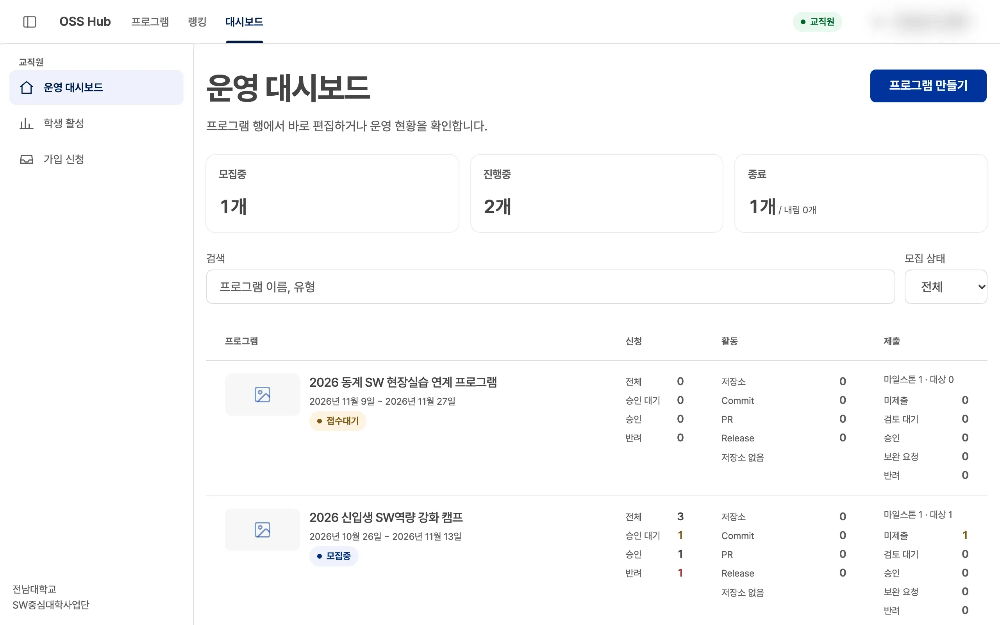
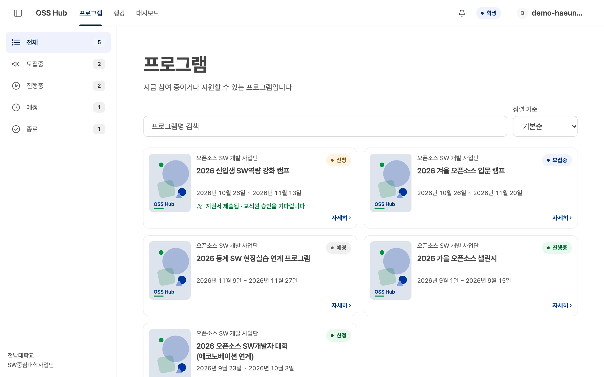
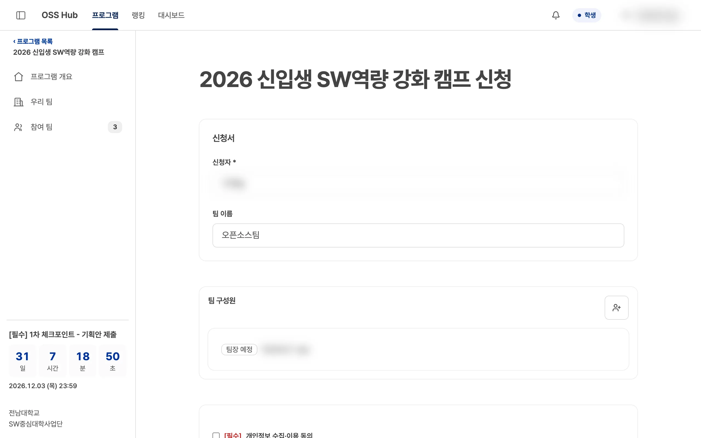
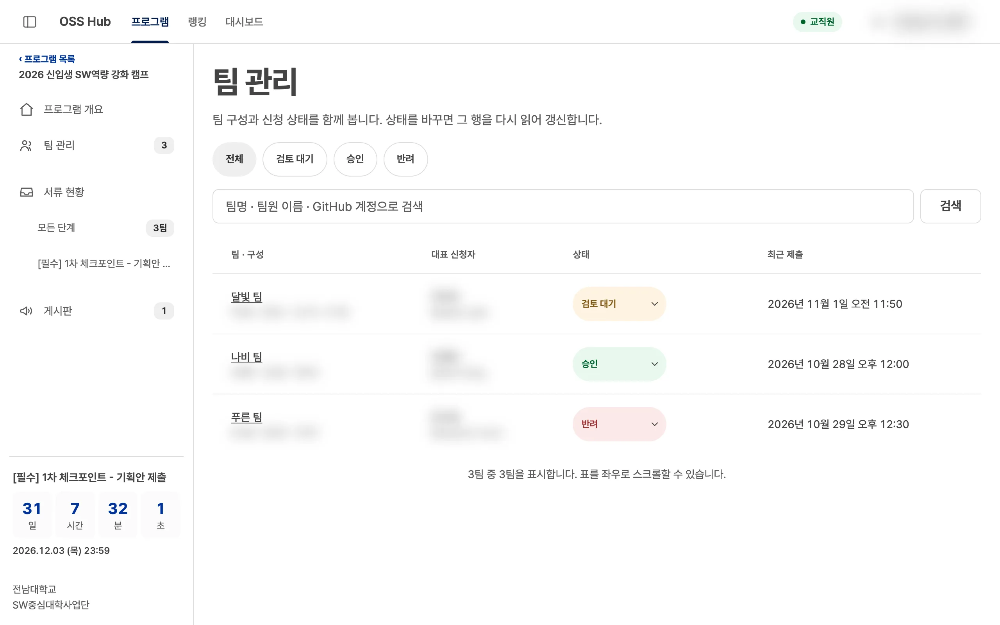
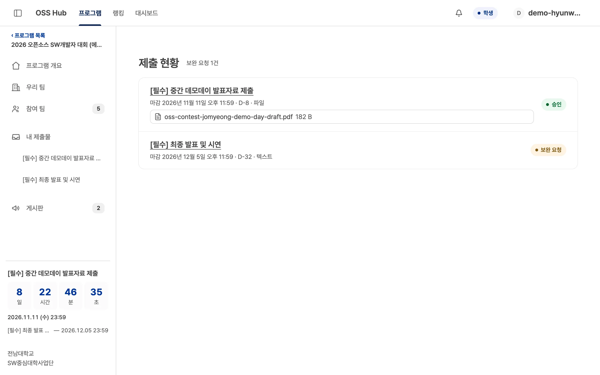
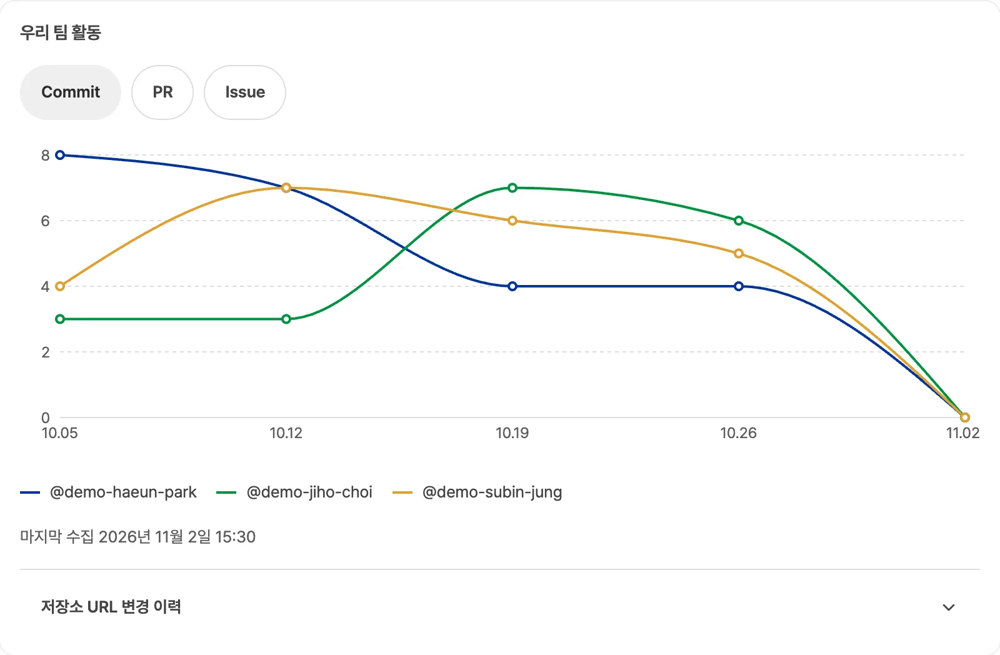
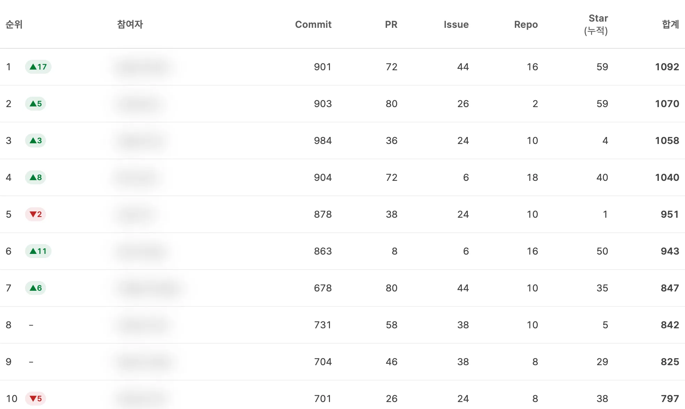
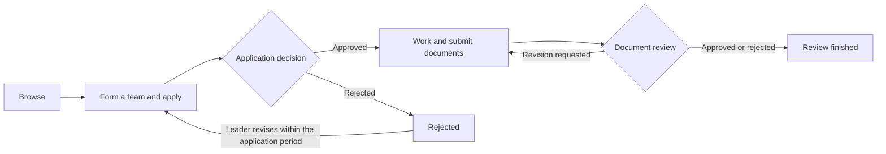
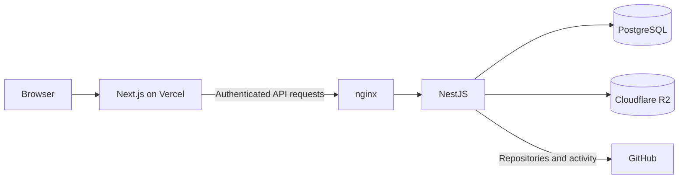

<h1 align="center">
  <a href="https://jnu-oss-hub.com">
    
  </a>
</h1>

<h3 align="center">OSS Hub handles applications, teams, and document review for the open-source competitions, hackathons, and study groups run by Chonnam National University's SW-Centered University Project Group.</h3>

<p align="center">Students sign in with GitHub, find a program, apply as a team, and submit documents such as plans and final deliverables. University staff approve or reject applications and review each document. Approved teams get a GitHub repository from the service or link one of their own. The service collects their commits, pull requests, and issues every hour.</p>

<p align="center">
  <b>Students and staff</b> use the service at <a href="https://jnu-oss-hub.com">jnu-oss-hub.com</a>. The <a href="https://jnu-swcu.github.io/oss-hub/">user guide</a> is in Korean. This repository is the service's source code. <b>Developers</b> can run it locally by following <a href="#getting-started-locally">Getting started locally</a>.
</p>

<p align="center">
  <a href="README.md">한국어</a> · <b>English</b>
</p>

<p align="center">
  <a href="https://github.com/JNU-SWCU/oss-hub/releases"></a>
  <a href="https://github.com/JNU-SWCU/oss-hub/actions/workflows/ci.yml"></a>
  <a href="https://jnu-oss-hub.com"></a>
  <a href="LICENSE"></a>
  <br>
  
  
  
  
  
</p>

<p align="center">
  <a href="https://jnu-oss-hub.com"><b>Visit OSS Hub</b></a> •
  <a href="https://jnu-swcu.github.io/oss-hub/"><b>User guide</b></a> •
  <a href="#screenshots">Screenshots</a> •
  <a href="#features">Features</a> •
  <a href="#how-a-program-runs">How a program runs</a> •
  <a href="#getting-started-locally">Getting started</a> •
  <a href="#contributing">Contributing</a>
</p>

---

## Screenshots

> [!NOTE]
> The service and these screenshots are in Korean. The people, GitHub IDs, and programs shown are made-up examples. The screens may differ slightly from the live service.

<p align="center">
  
  <br>
  The staff dashboard shows one row per program: pending approvals, repository activity, missing documents, and documents awaiting review.
</p>

<table>
  <tr>
    <td width="50%" valign="top"><b>Browse programs</b><br>Anyone can filter programs by recruiting status and read the schedule without signing in.<br><br></td>
    <td width="50%" valign="top"><b>Apply as a team</b><br>The team leader finds members by name or GitHub ID and invites them. Submitting the application also registers the team.<br><br></td>
  </tr>
  <tr>
    <td width="50%" valign="top"><b>Decide on applications</b><br>Staff approve or reject each team. A rejection needs a written reason.<br><br></td>
    <td width="50%" valign="top"><b>Submit documents</b><br>Each required document shows its own deadline and review result. D-9 means nine days left. After a revision request, the team resubmits by the date staff set.<br><br></td>
  </tr>
  <tr>
    <td width="50%" valign="top"><b>Team activity</b><br>GitHub activity collected every hour appears as a weekly trend for each team member.<br><br></td>
    <td width="50%" valign="top"><b>Activity ranking</b><br>Students rank by the sum of Commit, PR, Issue, Repo, and Star counts from their GitHub accounts. The table is public.<br><br></td>
  </tr>
</table>

## Features

- 🧭 **Browse without an account.** The program list, program details, ranking, and public projects need no sign-in.
- 👥 **Apply as a team.** The team leader invites members and submits the application, which also registers the team.
- ✅ **Decide from one list.** Staff approve or reject each team from the team list, and a rejection needs a reason.
- 🐙 **Repositories on approval.** If a program issues repositories, each approved team gets a private repository and its members get invitations.
- 📄 **Documents tracked one by one.** Each required document has its own deadline and review status, and after a revision request the team can resubmit by a set date.
- 📦 **Bulk download.** Staff download submitted files as a ZIP with a `제출현황.csv` manifest.
- 📊 **Hourly activity and a public ranking.** The service collects GitHub activity every hour and shows a weekly chart per team member and a public ranking.
- 📣 **Boards and notifications.** Each program has a board for notices and questions. Decisions arrive as in-app notifications and deadline reminders as email.

## How a program runs



1. **Browse.** Application dates, the schedule, and required documents are visible without signing in.
2. **Form a team and apply.** Sign in with GitHub, name the team, and invite members by name or GitHub ID. Only the team leader can submit the application.
3. **Application decision.** Staff approve or reject each team, and the result arrives as an in-app notification. If the program issues repositories, each approved team gets a private repository and its members get invitations. A rejected application can be revised and resubmitted by the team leader while the application period is open.
4. **Work and submit documents.** Teams work in their repository. Only approved applications can submit documents.
5. **Document review.** Staff approve, reject, or request a revision for each document. Approval and rejection are final. After a revision request, the team resubmits by the date staff set. Once a team resubmits after the deadline, it cannot change the document until the review is done.

Approving an application does not approve its documents. A plan and a final report are separate items, so each keeps its own deadline and status even when the dates match.

<details>
<summary><b>Detailed rules for decisions and submissions</b></summary>

- **Repository invitations.** Each member accepts their own GitHub invitation.
- **Linking your own repository.** The team leader or staff can register it. A repository outside the organization must be public.
- **Making a repository public.** If the team said on the application that it plans to make it public, staff can make it public after the program ends and required documents are approved.
- **Files.** The service accepts PDF, HWP, and ZIP files up to 5 MB.
- **Grace deadlines.** When staff set a grace deadline, the service accepts submissions until then and marks them late.
- **Deadline email.** If the program turns this on, members of approved teams that have not submitted a required document due within 24 hours get an email at 9:00 a.m. each day. Each member must also turn on email and set a mail address in their settings.
- **Ranking and collection scope.** The [GitHub activity policy](https://jnu-oss-hub.com/policies/github-activity) (in Korean) explains what is collected and shown.

</details>

### Roles

| Role | Starts | Can do | Guide (Korean) |
| --- | --- | --- | --- |
| **Student** (학생) · `STUDENT` | On sign-up | Apply to programs, join teams, submit and resubmit documents, see their own repositories and activity | [Student guide](https://jnu-swcu.github.io/oss-hub/student/) |
| **Staff** (교직원) · `STAFF`, meaning faculty and administrative staff | After approval | Create programs, including filling one in from a notice URL, decide on applications, review documents and request revisions, see student activity statistics | [Staff guide](https://jnu-swcu.github.io/oss-hub/staff/) |
| **Administrator** (관리자) · `ADMIN` | When granted | Everything staff can do, plus users and permissions, audit logs, system status, and manual collection | [Administrator guide](https://jnu-swcu.github.io/oss-hub/admin/) |

Member type and administrator permission are separate, so one account can be both staff and an administrator. Neither staff nor administrators can decide on their own team's application or review its documents.

### Getting help

- The [FAQ](https://jnu-swcu.github.io/oss-hub/faq/) (in Korean) answers common questions.
- Ask the staff member in charge or an administrator about a specific program.
- Report bugs and suggest changes in [GitHub Issues](https://github.com/JNU-SWCU/oss-hub/issues).
- Report security problems through the [security policy](SECURITY.md), not a public issue.

## Getting started locally

You need Node.js 24 or later (CI uses 24), Docker Compose, bash, and OpenSSL. Node.js 25 and later no longer ship corepack, so if the `corepack` command is missing, run `npm install -g corepack` first.

```bash
git clone https://github.com/JNU-SWCU/oss-hub.git
cd oss-hub
corepack enable
pnpm install

cp .envrc.example .envrc
echo "export SESSION_SECRET=$(openssl rand -hex 32)" >> .envrc
echo "export TEAM_JOIN_CODE_SECRET=$(openssl rand -hex 32)" >> .envrc
source .envrc

pnpm dev
```

Once it starts, the app is at <http://localhost:3000>. If you use direnv, you can run `direnv allow` in place of `source .envrc`.

The program list starts empty. To fill it, load the synthetic demo data (4 programs, 14 students, 1 staff member) from another terminal.

```bash
source .envrc
SEED_PROFILE=demo pnpm db:seed
```

> [!NOTE]
> There is no development login. You can browse public pages without one, but signing in requires a GitHub OAuth App of your own.

<details>
<summary><b>GitHub sign-in and role accounts</b></summary>

1. Create an OAuth App at <https://github.com/settings/developers>. Set the Homepage URL to `http://localhost:3000` and the callback URL to this address.

   ```text
   http://localhost:3000/api/v1/auth/github/callback
   ```

2. Replace `GITHUB_OAUTH_CLIENT_ID` and `GITHUB_OAUTH_CLIENT_SECRET` in `.envrc` with the values GitHub gave you.
3. To get an administrator account, set `AUTH_INITIAL_ROLES` to `<numeric GitHub ID>:ADMIN` before the first sign-in. Separate several entries with commas. The role can be `ADMIN`, `STAFF`, or `STUDENT`. Find a numeric ID at `https://api.github.com/users/<login>`. The value applies only to an active account that has no role or profile yet.
4. Run `source .envrc` again and restart `pnpm dev`.

The server starts with the GitHub App values blank. Fill them in only to try repository creation and activity collection. Git ignores `.envrc` and `secrets/`, and neither should ever be committed. `.env.example` lists production Compose values and is not for local development.

To remove the demo data, run this command.

```bash
source .envrc
pnpm --filter backend exec prisma db seed -- --profile demo --teardown
```

</details>

<details>
<summary><b>What <code>pnpm dev</code> does and how to stop it</b></summary>

`pnpm dev` checks six required environment variables (`DATABASE_URL`, `SESSION_SECRET`, `TEAM_JOIN_CODE_SECRET`, `FRONTEND_URL`, `GITHUB_OAUTH_CLIENT_ID`, `GITHUB_OAUTH_CLIENT_SECRET`) and ports 3000 and 4000. It then starts PostgreSQL and an S3-compatible mock file store in Docker, applies migrations, and starts the frontend and backend. It does not seed data.

The apps run on the host with hot reload, and when one exits the other stops too. `pnpm install` generates the Prisma Client. `MAIL_MODE=dry-run` in `.envrc.example` logs mail instead of sending it. [compose.dev.yml](compose.dev.yml) is the local infrastructure and [compose.yml](compose.yml) is the production runtime.

| Command | Result |
| --- | --- |
| `Ctrl+C` | Stops the frontend and backend. Containers keep running. |
| `docker compose -f compose.dev.yml stop` | Stops the containers and keeps the data. |
| `docker compose -f compose.dev.yml down` | Removes the containers and keeps the data in volumes. |
| `docker compose -f compose.dev.yml down -v` | Removes the containers and volumes, which deletes the data. |

</details>

## Architecture

| Area | Technology |
| --- | --- |
| Frontend | Next.js App Router, React, TypeScript, Tailwind CSS, Radix UI |
| Backend | NestJS, TypeScript, Prisma |
| Data and files | PostgreSQL, private Cloudflare R2 |
| Auth and integrations | GitHub OAuth, GitHub App for repository creation and activity collection, Gmail for mail |
| Testing | Vitest, Jest, Playwright with Chrome, GitHub Actions |
| Deployment | Vercel for the frontend, Docker Compose, nginx, and Jenkins for the backend |

This is how the main requests flow in production.



The browser calls the API at `/api/v1` on the frontend's domain, and only the backend reaches the database and file storage. See [compose.yml](compose.yml) for the production setup and [app.module.ts](apps/backend/src/app.module.ts) for the backend modules.

<details>
<summary><b>Repository layout</b></summary>

```text
apps/
├── frontend/            # Next.js screens, features, browser tests
└── backend/             # NestJS API, business rules, scheduled jobs
    └── prisma/          # Data model, migrations, seeds
docs/
├── assets/              # README images
├── design-tokens/       # Design tokens
└── translations/        # English PR and ticket templates
skills/                  # Agent procedures for this repository
guide/                   # User guide site (GitHub Pages)
deploy/                  # Deployment tools, nginx configuration, checks
.github/workflows/       # CI and frontend deployment
Jenkinsfile              # Backend deployment
dev.sh                   # Local development entry point
compose.dev.yml          # Local development infrastructure
compose.yml              # Production runtime
```

</details>

<details>
<summary><b>Deployment</b></summary>

- **Frontend.** Publishing a `vX.Y.Z` Release from a tag on `main` makes GitHub Actions deploy to Vercel, but only when the frontend changed.
- **Backend.** Jenkins checks for the latest Release about every 10 minutes. It confirms the tag is on `main`, backs up the database and file storage, builds the Docker image, and applies migrations. If the smoke test fails, it rolls back to the previous release.

</details>

## Contributing

Agree on scope and done criteria in an issue first. Set up with [Getting started locally](#getting-started-locally), then record the checks you actually ran in the PR. Run `bash .github/check-public-safe.sh` and make it pass before you open a PR.

See the [contributing guide](CONTRIBUTING.md), [code of conduct](CODE_OF_CONDUCT.md), and [security policy](SECURITY.md). These are in Korean, and the Korean text is authoritative. The repository's skills have `SKILL.en.md` versions, and `docs/translations/` has the templates in English.

<details>
<summary><b>Development and test commands</b></summary>

Run these from the repository root. The [CI workflow](.github/workflows/ci.yml) shows which checks each changed path needs.

| Purpose | Command |
| --- | --- |
| Lint and structure checks | `pnpm lint` |
| Type checks | `pnpm typecheck` |
| Frontend tests and backend unit tests | `pnpm test` |
| Build all apps | `pnpm build` |
| Format check | `pnpm format:check` |
| Backend database integration tests | `pnpm --filter backend test:integration` |
| Browser tests | `pnpm --filter frontend e2e` |
| Create a development migration | `pnpm db:migrate:dev` |

`pnpm test` leaves out the database integration tests and the browser tests. Integration tests use a dedicated isolated runner, and browser tests use an installed Chrome and a separate test environment. Run `pnpm --filter frontend e2e:install` to prepare the browser. The [Playwright config](apps/frontend/playwright.config.ts) has the details.

`pnpm build` needs an allowlisted HTTPS `BACKEND_ORIGIN`. In a shell that has loaded `.envrc`, pass the value CI uses.

```bash
BACKEND_ORIGIN=https://backend.example.test pnpm build
```

Run `git config core.hooksPath .githooks` to turn on the repository's Git hooks. They check commit message format and ban comments in staged app files, and run `pnpm format:check` before a push.

</details>

### Documentation map

| What you want to know | Document |
| --- | --- |
| Contribution steps and where to start | [CONTRIBUTING.md](CONTRIBUTING.md) (Korean) |
| Tests per changed path, and deployment | [CI workflow](.github/workflows/ci.yml) |
| Database and seeds | [Prisma notes](apps/backend/prisma/README.md) (Korean) |
| Frontend feature structure | [Features notes](apps/frontend/src/features/README.md) (Korean) |
| Design tokens and Figma | [Figma plugin notes](apps/frontend/figma-plugin/README.md) (Korean) |
| PR and issue templates | [PR template](docs/translations/pull-request-template.en.md), [work ticket](docs/translations/work-ticket.en.md) |

## License

[MIT](LICENSE)
