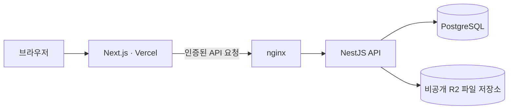

# OSS Hub

**한국어** | [English](README.en.md)

**학생의 오픈소스 활동과 교직원의 프로그램 운영을 연결하는 웹 서비스입니다.**

프로그램 탐색과 팀 구성부터 신청, 서류 제출·검토, GitHub 저장소와 활동 확인까지 한곳에서 이어갑니다.

[서비스 바로가기](https://jnu-oss-hub.com) · [개발자 온보딩](docs/onboarding.md) · [이슈](https://github.com/JNU-SWCU/oss-hub/issues) · [릴리스](https://github.com/JNU-SWCU/oss-hub/releases)

## 목차

- [주요 기능](#주요-기능)
- [사용자 역할과 참여 흐름](#사용자-역할과-참여-흐름)
- [화면 예시](#화면-예시)
- [기술 구성](#기술-구성)
- [로컬에서 시작하기](#로컬에서-시작하기)
- [저장소 구조](#저장소-구조)
- [개발과 검증](#개발과-검증)
- [문서 길잡이](#문서-길잡이)

## 주요 기능

| 기능                | 할 수 있는 일                                                                                 |
| ------------------- | --------------------------------------------------------------------------------------------- |
| 프로그램 탐색·신청  | 프로그램의 일정과 참여 조건을 확인하고 신청을 준비합니다.                                     |
| 팀 구성·참여        | 팀원을 초대하고 참여 상태를 확인하며 팀 단위로 신청합니다.                                    |
| 서류 제출           | 계획서·결과물 등 프로그램별 제출 항목의 마감, D-day와 제출 상태를 확인하고 파일을 제출합니다. |
| 신청 판정·제출 검토 | 신청을 승인·반려하고, 서류별 수합 요약과 팀별 현황을 보며 제출물을 검토합니다.                |
| GitHub 연동         | GitHub 계정으로 로그인하고 저장소를 연결해 활동을 확인합니다.                                 |
| 활동 공유·소통      | 공개 아카이브, 랭킹, 게시판과 알림을 통해 활동과 소식을 확인합니다.                           |

## 사용자 역할과 참여 흐름

| 역할               | 주요 사용 범위                                                                |
| ------------------ | ----------------------------------------------------------------------------- |
| **학생 · STUDENT** | 프로그램 신청, 팀 참여, 승인된 신청의 서류 제출·재제출, 본인 저장소·활동 확인 |
| **교직원 · STAFF** | 프로그램 운영, 신청 승인·반려, 제출물 검토와 보완 요청                        |
| **운영자 · ADMIN** | 프로그램 운영 권한에 더해 사용자·권한, 감사 로그와 시스템 관리                |

회원 유형과 운영 권한은 별도로 관리되며, 한 계정에 여러 권한이 부여될 수 있습니다.
신청 판정은 교직원의 업무이며, 운영 권한을 가진 운영자도 수행할 수 있습니다.
교직원과 운영자 모두 자신이 참여한 팀의 신청을 판정하거나 제출물을 검토할 수 없습니다.

일반적인 참여 흐름은 다음과 같습니다.

1. **탐색** — 프로그램의 신청 기간, 운영 일정과 제출 항목을 확인합니다.
2. **준비·신청** — 팀을 구성하고 필요한 신청 정보를 작성해 제출합니다.
3. **신청 판정** — 교직원이 신청을 검토하고 승인 또는 반려합니다.
4. **활동·제출·검토** — 승인된 팀이 서류를 제출하고, 검토 결과에 따라 보완합니다.

신청 승인과 개별 제출물의 검토 결과는 별도로 관리합니다.
계획서와 결과물도 각각의 제출 항목이므로 마감일이 같더라도 이름·마감·제출 상태를 구분합니다.

## 화면 예시

아래 화면은 합성 계정과 합성 프로그램으로 촬영한 기능 예시이며, 실제 사용자 데이터가 아닙니다.
촬영 시점의 화면으로 현재 서비스와 일부 차이가 있을 수 있습니다.

### 서류별 마감과 D-day

계획서와 결과물의 마감일, 남은 날짜와 제출 상태를 각각 확인합니다.


<details>
<summary>신청 준비·팀원 초대 화면 보기</summary>

신청 정보를 작성하고 팀원을 초대하는 화면입니다.


</details>

<details>
<summary>교직원의 서류 수합 요약 화면 보기</summary>

서류별 제출 현황을 요약해서 보고 검토할 대상을 찾는 화면입니다.


</details>

## 기술 구성

| 영역        | 기술                                                          |
| ----------- | ------------------------------------------------------------- |
| 프런트엔드  | Next.js App Router, React, TypeScript, Tailwind CSS, Radix UI |
| 백엔드      | NestJS, TypeScript, Prisma                                    |
| 데이터·파일 | PostgreSQL, 비공개 Cloudflare R2 파일 저장소                  |
| 인증·연동   | GitHub OAuth, GitHub 저장소·활동 수집                         |
| 검증        | Vitest, Jest, Playwright · Chrome, GitHub Actions             |
| 배포        | 프런트엔드 Vercel, 백엔드 Docker Compose · nginx · Jenkins    |

운영 환경의 주요 요청 흐름입니다.



브라우저는 프런트엔드와 같은 도메인의 `/api/v1`을 사용하며, 데이터베이스와 파일 저장소 접근은 백엔드가 담당합니다.
세부 경계와 배포 방식은 [시스템 지도](docs/architecture.md)와 [기술 결정 기록](docs/decisions/README.md)을 참고하세요.

## 로컬에서 시작하기

### 준비할 도구

- Node.js **24 이상**
- pnpm **11.0.0** — 저장소의 `packageManager` 기준
- Docker와 Docker Compose
- direnv — 사용하는 셸에 연동 필요

### 1. 저장소와 의존성 준비

```bash
git clone https://github.com/JNU-SWCU/oss-hub.git
cd oss-hub
corepack enable
pnpm install
cp .envrc.example .envrc
```

`pnpm install`은 백엔드의 Prisma Client도 생성합니다.

### 2. 로컬 설정 입력

`.envrc`의 안내에 따라 **서로 다른 서명 키 두 개**(`SESSION_SECRET`, `TEAM_JOIN_CODE_SECRET`)를 생성해 입력합니다.
실제 GitHub 로그인을 사용하려면 개발용 OAuth App의 Client ID와 Client Secret도 입력해야 합니다.
예제의 OAuth 값은 로그인에 사용할 수 없는 placeholder입니다.

OAuth App의 로컬 콜백 주소는 다음과 일치해야 합니다.

```text
http://localhost:3000/api/v1/auth/github/callback
```

설정을 마친 뒤 셸에 적용합니다.

```bash
direnv allow
```

GitHub App 연동과 역할별 테스트 계정 준비는 [로컬 개발 안내](docs/rules/local-dev.md)와 [온보딩](docs/onboarding.md)을 참고하세요.
역할별 테스트 계정은 첫 로그인 전에 `.envrc`의 `AUTH_INITIAL_ROLES`에 설정합니다.
`.envrc`와 개인키 파일은 Git에 올리지 않습니다.
로컬 설정의 시작점은 `.envrc.example`이며, `.env.example`은 운영 Compose가 요구하는 환경 변수 목록입니다.

### 3. 실행

```bash
pnpm dev
```

[http://localhost:3000](http://localhost:3000)에서 접속합니다.
이 명령은 필수 설정과 포트 `3000`·`4000`을 확인하고, 개발 인프라 기동과 기존 마이그레이션 적용 후 프런트엔드·백엔드를 실행합니다.
앱은 호스트에서 hot reload로 실행되며, Docker는 개발용 PostgreSQL과 파일 저장소에 사용합니다.
`compose.yml`은 운영용이며 로컬 실행에는 `compose.dev.yml`을 사용합니다.

### 4. 개발 종료

`Ctrl+C`로 앱을 종료한 뒤, 개발 인프라도 더 쓰지 않으면 다음 명령으로 중지합니다.
저장된 개발 데이터는 유지됩니다.

```bash
docker compose -f compose.dev.yml stop
```

## 저장소 구조

```text
apps/
├── frontend/            # Next.js 화면·기능·브라우저 테스트
└── backend/             # NestJS API·업무 규칙·작업 처리
    └── prisma/          # 데이터 모델·마이그레이션
docs/
├── decisions/           # 기술·운영 결정 기록
├── rules/               # 개발·보안·검증 규칙
└── deploy/              # 배포·운영 안내
scripts/                 # 개발·검증·배포 보조 스크립트
skills/                  # 저장소 전용 에이전트 작업 절차
deploy/                  # nginx·Jenkins 설정
.github/workflows/       # CI
compose.dev.yml          # 로컬 개발 인프라
compose.yml              # 운영 런타임
```

## 개발과 검증

저장소 루트에서 실행합니다.
변경한 경로에 필요한 검증은 [CI 경로별 검증 규칙](docs/rules/ci-path-verification.md)을 기준으로 선택합니다.

| 목적                                 | 명령                                     |
| ------------------------------------ | ---------------------------------------- |
| 코드·구조 검사                       | `pnpm lint`                              |
| 타입 검사                            | `pnpm typecheck`                         |
| 프런트엔드 테스트·백엔드 단위 테스트 | `pnpm test`                              |
| 전체 앱 빌드                         | `pnpm build`                             |
| 포맷 검사                            | `pnpm format:check`                      |
| 백엔드 DB 통합 테스트                | `pnpm --filter backend test:integration` |
| 브라우저 테스트                      | `pnpm --filter frontend e2e`             |
| 개발 마이그레이션 생성               | `pnpm db:migrate:dev`                    |

`pnpm test`에는 백엔드 DB 통합 테스트와 브라우저 테스트가 포함되지 않습니다.
DB 통합 테스트는 전용 격리 실행기를 사용하고, 브라우저 테스트는 설치된 Chrome과 별도 테스트 환경을 사용합니다.
브라우저 준비 명령은 `pnpm --filter frontend e2e:install`이며, 세부 실행 조건은 검증 규칙을 참고하세요.

변경 사항은 이슈의 범위와 완료 조건에 맞춰 작성하고, 실제 수행한 검증을 PR에 기록합니다.
기여를 시작할 때는 [온보딩](docs/onboarding.md), [PR 범위·제출 규칙](docs/rules/pr-scope.md), [보안 규칙](docs/rules/security.md)을 먼저 확인하세요.

## 문서 길잡이

| 알고 싶은 내용             | 문서                                               |
| -------------------------- | -------------------------------------------------- |
| 팀 참여와 첫 작업 시작     | [온보딩](docs/onboarding.md)                       |
| 환경 설정·로그인·로컬 실행 | [로컬 개발 안내](docs/rules/local-dev.md)          |
| 시스템 경계와 요청 흐름    | [아키텍처](docs/architecture.md)                   |
| 기술 선택의 이유           | [ADR 인덱스](docs/decisions/README.md)             |
| 변경 경로별 테스트         | [CI 검증 규칙](docs/rules/ci-path-verification.md) |
| PR 작성과 검토             | [PR 범위·제출 규칙](docs/rules/pr-scope.md)        |
| 공개 저장소와 데이터 보호  | [보안 규칙](docs/rules/security.md)                |
| 배포 전 확인               | [배포 검증 안내](docs/deploy/pre-deploy-verify.md) |
| 에이전트의 작업 기준       | [AGENTS.md](AGENTS.md)                             |

기능 개선과 알려진 문제의 최신 상태는 [GitHub Issues](https://github.com/JNU-SWCU/oss-hub/issues)에서 확인할 수 있습니다.
