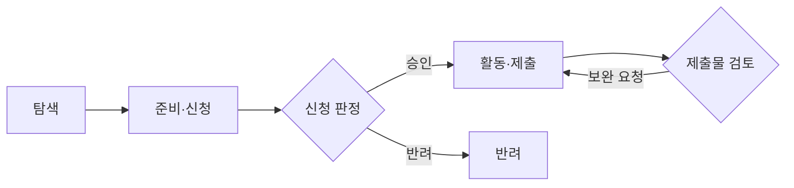
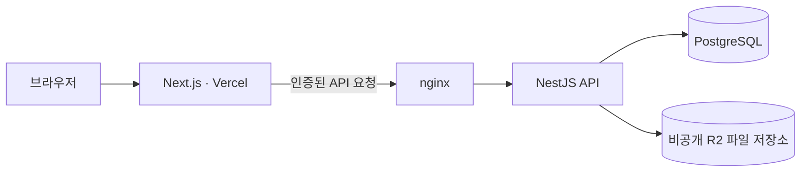

<h1 align="center">
  <a href="https://jnu-oss-hub.com">
    
  </a>
</h1>

<h3 align="center">전남대학교 SW중심대학사업단이 여는 오픈소스 경진대회·해커톤·스터디의 신청과 운영을 맡는 웹 서비스</h3>

<p align="center">학생은 프로그램을 찾아 팀으로 신청하고 서류를 제출합니다. 교직원은 신청을 승인·반려하고 제출물을 검토합니다. 승인된 팀은 서비스가 만든 GitHub 저장소나 직접 연결한 저장소에서 활동하고, 그 기록을 서비스에서 확인합니다.</p>

<p align="center">
  <b>학생과 교직원</b>은 <a href="https://jnu-oss-hub.com">jnu-oss-hub.com</a>에서 이용하고, 사용법은 <a href="https://jnu-swcu.github.io/oss-hub/">사용 가이드</a>에서 봅니다. 이 저장소는 서비스의 소스 코드이며, <b>기여할 개발자</b>는 <a href="#로컬에서-시작하기">로컬에서 시작하기</a>로 내려받아 실행합니다.
</p>

<p align="center">
  <b>한국어</b> · <a href="README.en.md">English</a>
</p>

<p align="center">
  <a href="https://github.com/JNU-SWCU/oss-hub/releases"></a>
  <a href="https://github.com/JNU-SWCU/oss-hub/actions/workflows/ci.yml"></a>
  <a href="https://jnu-oss-hub.com"></a>
  <a href="LICENSE"></a>
  <br>
  
  
  
  
  
</p>

<p align="center">
  <a href="https://jnu-oss-hub.com"><b>서비스 바로가기</b></a> •
  <a href="https://jnu-swcu.github.io/oss-hub/"><b>사용 가이드</b></a> •
  <a href="#화면-예시">화면 예시</a> •
  <a href="#주요-기능">주요 기능</a> •
  <a href="#참여-흐름">참여 흐름</a> •
  <a href="#로컬에서-시작하기">로컬에서 시작하기</a> •
  <a href="#기여하기">기여하기</a>
</p>

---

## 화면 예시

> [!NOTE]
> 합성 계정과 합성 프로그램으로 촬영한 기능 예시이며, 실제 사용자 데이터가 아닙니다. 촬영 시점의 화면으로 현재 서비스와 일부 차이가 있을 수 있습니다.

<table>
  <tr>
    <td width="50%" valign="top">
      <b>서류별 마감과 D-day</b><br>
      계획서와 결과물의 마감일, 남은 날짜와 제출 상태를 각각 확인합니다.<br><br>
      
    </td>
    <td width="50%" valign="top">
      <b>신청 준비와 팀원 초대</b><br>
      신청 정보를 작성하고 팀원을 초대합니다.<br><br>
      
    </td>
  </tr>
  <tr>
    <td width="50%" valign="top">
      <b>교직원의 서류 수합 요약</b><br>
      서류별 제출 현황을 요약해서 보고 검토할 대상을 찾습니다.<br><br>
      
    </td>
    <td width="50%" valign="top">
      <b>활동 랭킹</b><br>
      활동 랭킹을 확인합니다.<br><br>
      
    </td>
  </tr>
</table>

## 주요 기능

- 🧭 **프로그램 탐색·신청.** 프로그램의 일정과 참여 조건을 확인하고 신청을 준비합니다.
- 👥 **팀 구성·참여.** 팀원을 초대하고 참여 상태를 확인하며 팀 단위로 신청합니다.
- 📄 **서류 제출.** 계획서·결과물 등 프로그램별 제출 항목의 마감, D-day와 제출 상태를 확인하고 파일을 제출합니다.
- ✅ **신청 판정·제출 검토.** 신청을 승인·반려하고, 서류별 수합 요약과 팀별 현황을 보며 제출물을 검토합니다.
- 🐙 **GitHub 연동.** GitHub 계정으로 로그인하고 저장소를 연결해 활동을 확인합니다.
- 🏆 **활동 공유·소통.** 종료된 프로그램과 공개 프로젝트, 랭킹, 게시판과 알림을 통해 활동과 소식을 확인합니다.

## 참여 흐름



1. **탐색.** 프로그램의 신청 기간, 운영 일정과 제출 항목을 확인합니다.
2. **준비·신청.** 팀을 구성하고 필요한 신청 정보를 작성해 제출합니다.
3. **신청 판정.** 교직원이 신청을 검토하고 승인 또는 반려합니다.
4. **활동·제출·검토.** 승인된 팀이 서류를 제출하고, 검토 결과에 따라 보완합니다.

신청 승인과 개별 제출물의 검토 결과는 별도로 관리합니다.
계획서와 결과물도 각각의 제출 항목이므로 마감일이 같더라도 이름·마감·제출 상태를 구분합니다.

### 역할

| 역할               | 주요 사용 범위                                                                |
| ------------------ | ----------------------------------------------------------------------------- |
| **학생 · STUDENT** | 프로그램 신청, 팀 참여, 승인된 신청의 서류 제출·재제출, 본인 저장소·활동 확인 |
| **교직원 · STAFF** | 프로그램 운영, 신청 승인·반려, 제출물 검토와 보완 요청                        |
| **운영자 · ADMIN** | 프로그램 운영 권한에 더해 사용자·권한, 감사 로그와 시스템 관리                |

회원 유형과 운영 권한은 별도로 관리되며, 한 계정에 여러 권한이 부여될 수 있습니다.
신청 판정은 교직원의 업무이며, 운영 권한을 가진 운영자도 수행할 수 있습니다.

> [!IMPORTANT]
> 교직원과 운영자 모두 자신이 참여한 팀의 신청을 판정하거나 제출물을 검토할 수 없습니다.

## 로컬에서 시작하기

**필요한 도구:** Node.js 24 이상 · pnpm 11.0.0(`packageManager` 기준) · Docker와 Docker Compose · 셸에 연동한 direnv

```bash
git clone https://github.com/JNU-SWCU/oss-hub.git
cd oss-hub
corepack enable
pnpm install
cp .envrc.example .envrc
```

`pnpm install`은 백엔드의 Prisma Client도 생성합니다.
`.envrc`의 안내에 따라 **서로 다른 서명 키 두 개**(`SESSION_SECRET`, `TEAM_JOIN_CODE_SECRET`)를 생성해 입력한 뒤 실행합니다.

```bash
direnv allow
pnpm dev
```

[http://localhost:3000](http://localhost:3000)에서 접속합니다.

<details>
<summary><b>GitHub 로그인과 테스트 계정 설정</b></summary>

실제 GitHub 로그인을 사용하려면 개발용 OAuth App의 Client ID와 Client Secret도 `.envrc`에 입력해야 합니다.
예제의 OAuth 값은 로그인에 사용할 수 없는 placeholder입니다.

OAuth App의 로컬 콜백 주소는 다음과 일치해야 합니다.

```text
http://localhost:3000/api/v1/auth/github/callback
```

GitHub App 연동과 역할별 테스트 계정 준비는 [개발 실행 스크립트](scripts/dev.sh)와 [`.envrc.example`](.envrc.example)을 참고하세요.
역할별 테스트 계정은 첫 로그인 전에 `.envrc`의 `AUTH_INITIAL_ROLES`에 설정합니다.
`.envrc`와 개인키 파일은 Git에 올리지 않습니다.
로컬 설정의 시작점은 `.envrc.example`이며, `.env.example`은 운영 Compose가 요구하는 환경 변수 목록입니다.

</details>

<details>
<summary><b><code>pnpm dev</code>가 하는 일과 개발 종료</b></summary>

이 명령은 필수 설정과 포트 `3000`·`4000`을 확인하고, 개발 인프라 기동과 기존 마이그레이션 적용 후 프런트엔드·백엔드를 실행합니다.
앱은 호스트에서 hot reload로 실행되며, Docker는 개발용 PostgreSQL과 파일 저장소에 사용합니다.
`compose.yml`은 운영용이며 로컬 실행에는 `compose.dev.yml`을 사용합니다.

`Ctrl+C`로 앱을 종료한 뒤, 개발 인프라도 더 쓰지 않으면 다음 명령으로 중지합니다.
저장된 개발 데이터는 유지됩니다.

```bash
docker compose -f compose.dev.yml stop
```

</details>

## 기술 구성

| 영역        | 기술                                                          |
| ----------- | ------------------------------------------------------------- |
| 프런트엔드  | Next.js App Router, React, TypeScript, Tailwind CSS, Radix UI |
| 백엔드      | NestJS, TypeScript, Prisma                                    |
| 데이터·파일 | PostgreSQL, 비공개 Cloudflare R2 파일 저장소                  |
| 인증·연동   | GitHub OAuth, GitHub 저장소·활동 수집                         |
| 검증        | Vitest, Jest, Playwright · Chrome, GitHub Actions             |
| 배포        | 프런트엔드 Vercel, 백엔드 Docker Compose · nginx · Jenkins    |

운영 환경의 주요 요청 흐름입니다.



브라우저는 프런트엔드와 같은 도메인의 `/api/v1`을 사용하며, 데이터베이스와 파일 저장소 접근은 백엔드가 담당합니다.
세부 경계와 배포 방식은 [운영 구성](compose.yml)과 [백엔드 모듈 구성](apps/backend/src/app.module.ts)을 참고하세요.

<details>
<summary><b>저장소 구조</b></summary>

```text
apps/
├── frontend/            # Next.js 화면·기능·브라우저 테스트
└── backend/             # NestJS API·업무 규칙·작업 처리
    └── prisma/          # 데이터 모델·마이그레이션
docs/design-tokens/      # 디자인 토큰
scripts/                 # 개발·검증·배포 보조 스크립트
skills/                  # 저장소 전용 에이전트 작업 절차
deploy/                  # nginx·Jenkins 설정
.github/workflows/       # CI
compose.dev.yml          # 로컬 개발 인프라
compose.yml              # 운영 런타임
```

</details>

## 기여하기

변경 사항은 이슈의 범위와 완료 조건에 맞춰 작성하고, 실제 수행한 검증을 PR에 기록합니다.
기여를 시작할 때는 [로컬에서 시작하기](#로컬에서-시작하기), [PR 증거 절차](skills/submit-pr-evidence/SKILL.md), [공개 안전 검사](scripts/check-public-safe.sh)를 먼저 확인하세요.
자세한 절차는 [기여 안내](CONTRIBUTING.md), 참여 규칙은 [행동 강령](CODE_OF_CONDUCT.md), 취약점 신고는 [보안 정책](SECURITY.md)을 따릅니다.

<details>
<summary><b>개발과 검증 명령</b></summary>

저장소 루트에서 실행합니다.
변경한 경로에 필요한 검증은 [CI workflow](.github/workflows/ci.yml)를 기준으로 선택합니다.

| 목적                                 | 명령                                     |
| ------------------------------------ | ---------------------------------------- |
| 코드·구조 검사                       | `pnpm lint`                              |
| 타입 검사                            | `pnpm typecheck`                         |
| 프런트엔드 테스트·백엔드 단위 테스트 | `pnpm test`                              |
| 전체 앱 빌드                         | `pnpm build`                             |
| 포맷 검사                            | `pnpm format:check`                      |
| 백엔드 DB 통합 테스트                | `pnpm --filter backend test:integration` |
| 브라우저 테스트                      | `pnpm --filter frontend e2e`             |
| 개발 마이그레이션 생성               | `pnpm db:migrate:dev`                    |

`pnpm test`에는 백엔드 DB 통합 테스트와 브라우저 테스트가 포함되지 않습니다.
DB 통합 테스트는 전용 격리 실행기를 사용하고, 브라우저 테스트는 설치된 Chrome과 별도 테스트 환경을 사용합니다.
브라우저 준비 명령은 `pnpm --filter frontend e2e:install`이며, 세부 실행 조건은 [Playwright 설정](apps/frontend/playwright.config.ts)을 참고하세요.

</details>

### 문서 길잡이

| 알고 싶은 내용             | 문서                                               |
| -------------------------- | -------------------------------------------------- |
| 팀 참여와 첫 작업 시작     | [로컬에서 시작하기](#로컬에서-시작하기)            |
| 환경 설정·로그인·로컬 실행 | [개발 실행 스크립트](scripts/dev.sh)               |
| 시스템 경계와 요청 흐름    | [운영 구성](compose.yml)                           |
| 백엔드 모듈 구성           | [AppModule](apps/backend/src/app.module.ts)        |
| 변경 경로별 테스트와 배포 전 확인 | [CI workflow](.github/workflows/ci.yml)            |
| PR 작성과 검토             | [PR 증거 절차](skills/submit-pr-evidence/SKILL.md) |
| 공개 저장소와 데이터 보호  | [공개 안전 검사](scripts/check-public-safe.sh)     |

기능 개선과 알려진 문제의 최신 상태는 [GitHub Issues](https://github.com/JNU-SWCU/oss-hub/issues)에서 확인할 수 있습니다.

## 라이선스

[MIT](LICENSE)
