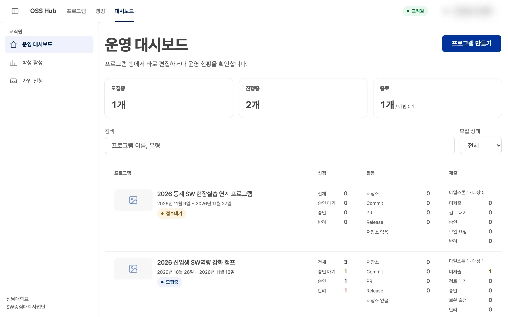
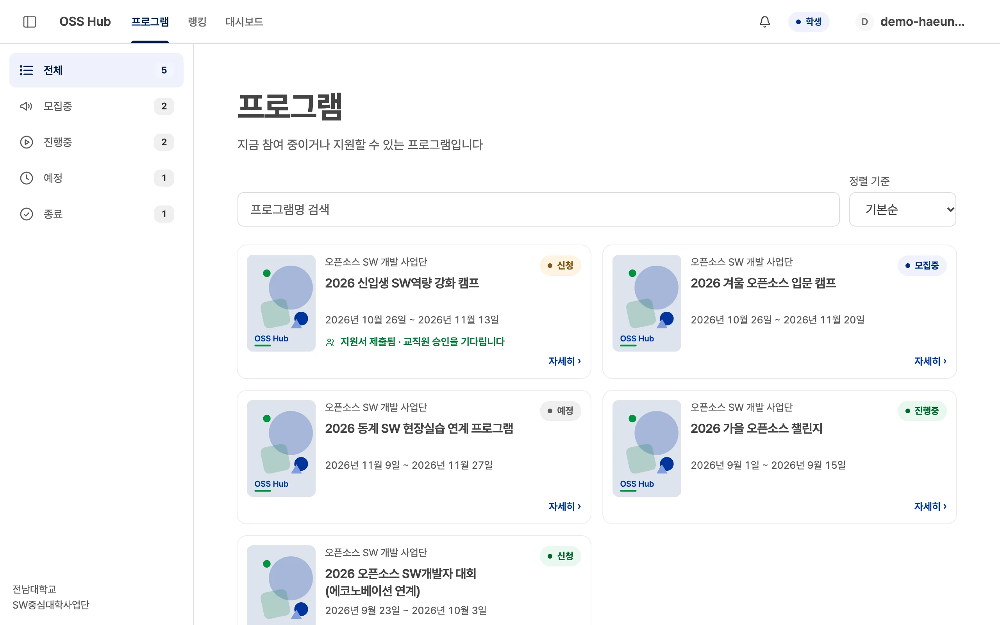
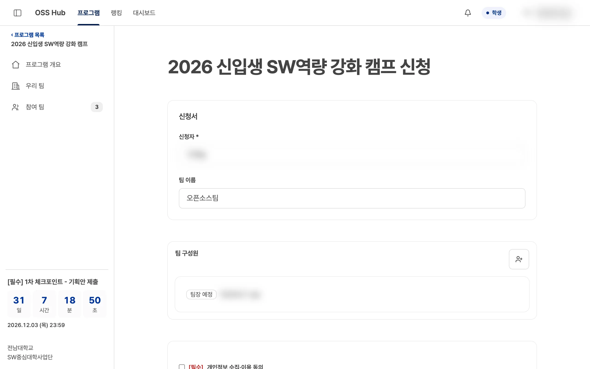
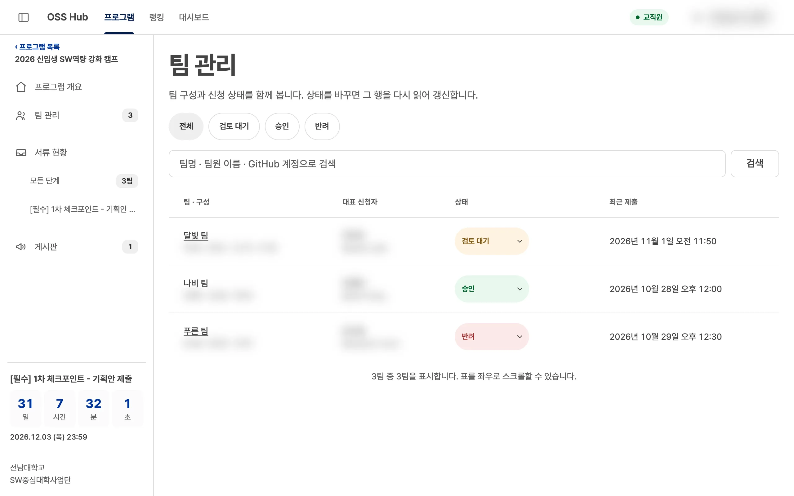
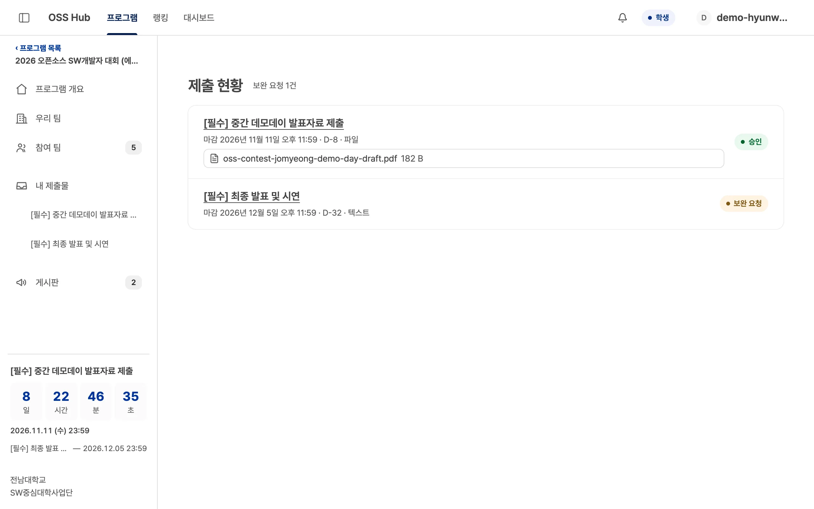
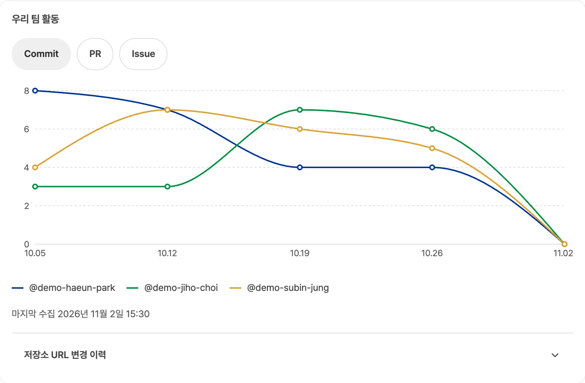
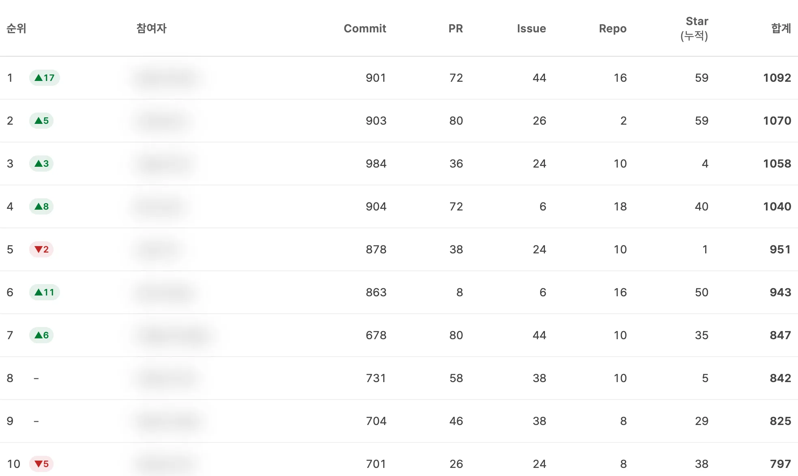
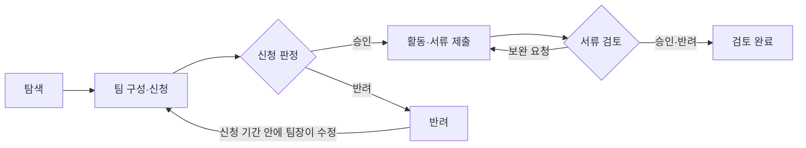
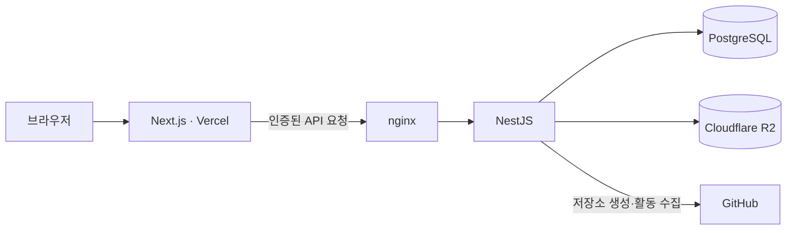

<h1 align="center">
  <a href="https://jnu-oss-hub.com">
    
  </a>
</h1>

<h3 align="center">전남대학교 SW중심대학사업단의 오픈소스 경진대회·해커톤·스터디를 신청부터 서류 검토까지 운영하는 웹 서비스</h3>

<p align="center">학생은 GitHub 계정으로 로그인해 프로그램을 찾고 팀으로 신청한 뒤 계획서와 결과물 같은 서류를 냅니다. 교직원은 신청을 승인하거나 반려하고 서류를 검토합니다. 승인된 팀은 서비스가 만들어 주는 GitHub 저장소나 직접 연결한 저장소에서 활동합니다. 서비스는 커밋, PR, 이슈 같은 활동을 1시간마다 모아 보여 줍니다.</p>

<p align="center">
  <b>학생과 교직원</b>은 <a href="https://jnu-oss-hub.com">jnu-oss-hub.com</a>에서 바로 이용합니다. 사용법은 <a href="https://jnu-swcu.github.io/oss-hub/">사용 가이드</a>에서 봅니다. 이 저장소는 서비스의 소스 코드입니다. <b>기여할 개발자</b>는 <a href="#로컬에서-시작하기">로컬에서 시작하기</a>를 따라 직접 실행해 봅니다.
</p>

<p align="center">
  <b>한국어</b> · <a href="README.en.md">English</a>
</p>

<p align="center">
  <a href="https://github.com/JNU-SWCU/oss-hub/releases"></a>
  <a href="https://github.com/JNU-SWCU/oss-hub/actions/workflows/ci.yml"></a>
  <a href="https://jnu-oss-hub.com"></a>
  <a href="LICENSE"></a>
  <br>
  
  
  
  
  
</p>

<p align="center">
  <a href="https://jnu-oss-hub.com"><b>서비스 바로가기</b></a> •
  <a href="https://jnu-swcu.github.io/oss-hub/"><b>사용 가이드</b></a> •
  <a href="#화면-예시">화면 예시</a> •
  <a href="#주요-기능">주요 기능</a> •
  <a href="#참여-흐름">참여 흐름</a> •
  <a href="#로컬에서-시작하기">로컬에서 시작하기</a> •
  <a href="#기여하기">기여하기</a>
</p>

---

## 화면 예시

> [!NOTE]
> 예시 데이터로 촬영한 화면입니다. 프로그램과 사람은 모두 예시입니다. 촬영 시점의 화면이라 현재 서비스와 조금 다를 수 있습니다.

<p align="center">
  
  <br>
  교직원 화면입니다. 프로그램마다 승인 대기, 저장소 활동, 미제출과 검토 대기 건수를 한 줄로 보여 줍니다.
</p>

<table>
  <tr>
    <td width="50%" valign="top"><b>프로그램 둘러보기</b><br>로그인하지 않아도 모집 상태별로 프로그램을 찾고 일정을 볼 수 있습니다.<br><br></td>
    <td width="50%" valign="top"><b>팀으로 신청하기</b><br>팀장이 이름이나 GitHub 아이디로 팀원을 찾아 초대합니다. 팀장이 신청서를 내면 팀도 함께 등록됩니다.<br><br></td>
  </tr>
  <tr>
    <td width="50%" valign="top"><b>신청 판정</b><br>교직원이 팀별로 승인하거나 반려합니다. 반려할 때는 사유를 적어야 합니다.<br><br></td>
    <td width="50%" valign="top"><b>서류 제출</b><br>제출 항목마다 마감과 검토 결과를 따로 보여 줍니다. 보완 요청을 받으면 정해진 기한까지 다시 냅니다.<br><br></td>
  </tr>
  <tr>
    <td width="50%" valign="top"><b>팀 활동</b><br>1시간마다 GitHub 활동을 모아 팀원별 주간 추이로 보여 줍니다.<br><br></td>
    <td width="50%" valign="top"><b>활동 랭킹</b><br>학생의 GitHub 계정 활동을 Commit, PR, Issue, Repo, Star 합계로 줄 세웁니다. 표는 로그인 없이 볼 수 있습니다.<br><br></td>
  </tr>
</table>

## 주요 기능

- 🧭 **로그인 없이 둘러보기.** 프로그램 목록과 상세, 랭킹, 공개 프로젝트를 계정 없이 볼 수 있습니다.
- 👥 **팀원 초대와 팀 신청.** 팀장이 팀원을 초대하고 신청서를 내면 팀도 함께 등록됩니다.
- ✅ **목록에서 바로 판정.** 교직원이 팀 목록에서 승인·반려합니다. 반려할 때는 사유를 남깁니다.
- 🐙 **승인된 팀의 저장소 발급.** 저장소 발급을 켠 프로그램은 승인된 팀에 비공개 저장소를 만들고 팀원을 초대합니다.
- 📄 **서류별 마감과 상태.** 제출 항목마다 마감과 검토 결과를 따로 보여 줍니다. 보완 요청을 받으면 기한 안에 다시 냅니다.
- 📦 **서류 일괄 내려받기.** 제출 파일을 `제출현황.csv`와 함께 ZIP으로 받습니다.
- 📊 **1시간마다 활동 수집.** GitHub 활동을 모아 팀원별 주간 그래프와 공개 랭킹으로 보여 줍니다.
- 📣 **게시판과 알림.** 프로그램별 공지·질문 게시판이 있습니다. 판정 결과는 앱 알림으로, 마감 안내는 메일로 받습니다.

## 참여 흐름



1. **탐색.** 신청 기간, 운영 일정, 제출 항목을 로그인 없이 봅니다.
2. **팀 구성·신청.** GitHub로 로그인해 팀 이름을 정하고 이름이나 GitHub 아이디로 팀원을 초대합니다. 신청서는 팀장만 낼 수 있습니다.
3. **신청 판정.** 교직원이 팀별로 승인하거나 반려하면 결과가 앱 알림으로 갑니다. 저장소 발급을 켠 프로그램은 승인된 팀에 비공개 저장소를 만들고 팀원을 초대합니다. 반려된 신청은 신청 기간 안에 팀장이 고쳐서 다시 낼 수 있습니다.
4. **활동·서류 제출.** 팀은 저장소에서 활동합니다. 서류는 승인된 신청에서만 낼 수 있습니다.
5. **서류 검토.** 교직원이 서류마다 승인·보완 요청·반려를 정합니다. 승인과 반려는 최종입니다. 보완 요청을 받으면 정해진 기한까지 다시 냅니다. 마감 뒤에 다시 낸 서류는 검토가 끝날 때까지 고칠 수 없습니다.

신청 승인과 서류 승인은 별개입니다. 계획서와 결과물은 서로 다른 제출 항목입니다. 마감일이 같아도 마감과 제출 상태를 따로 봅니다.

<details>
<summary><b>판정과 제출의 세부 규칙</b></summary>

- **저장소 초대.** GitHub 초대는 팀원이 각자 수락합니다.
- **직접 만든 저장소 연결.** 팀장이나 교직원이 등록합니다. 운영 조직 밖의 저장소라면 공개 저장소여야 합니다.
- **공개 전환.** 프로그램이 끝나고 필수 서류가 승인된 뒤, 신청서에서 공개 예정으로 표시한 팀의 저장소를 교직원이 공개로 바꿉니다.
- **파일.** PDF, HWP, ZIP을 5 MB까지 받습니다.
- **유예 기한.** 교직원이 유예 기한을 정하면 원래 마감 뒤에도 그 시각까지 받습니다. 이렇게 낸 서류는 지각 제출로 표시합니다.
- **마감 안내 메일.** 프로그램에서 켜 두면 매일 오전 9시에 메일이 갑니다. 받는 사람은 24시간 안에 마감인 필수 서류를 아직 내지 않은 승인 팀의 팀원입니다. 팀원도 설정에서 메일 수신을 켜고 메일 주소를 등록해야 합니다.
- **랭킹과 수집 범위.** 수집 항목과 공개 범위는 [GitHub 활동 수집·공개 범위](https://jnu-oss-hub.com/policies/github-activity)에서 설명합니다.

</details>

### 역할

| 역할 | 시작 | 하는 일 | 가이드 |
| --- | --- | --- | --- |
| 학생 · `STUDENT` | 가입 즉시 | 프로그램 신청, 팀 참여, 서류 제출과 재제출, 본인 저장소와 활동 확인 | [학생 가이드](https://jnu-swcu.github.io/oss-hub/student/) |
| 교직원 · `STAFF` | 승인 후 | 프로그램 생성(공지 글 주소로 내용 채우기 포함), 신청 판정, 서류 검토와 보완 요청, 학생 활성 통계 | [교직원 가이드](https://jnu-swcu.github.io/oss-hub/staff/) |
| 관리자 · `ADMIN` | 권한 부여 후 | 교직원 업무에 더해 사용자와 권한 관리, 감사 로그, 시스템 상태 확인과 수동 수집 | [관리자 가이드](https://jnu-swcu.github.io/oss-hub/admin/) |

회원 유형과 관리자 권한은 따로 관리하므로 한 계정이 교직원이면서 관리자일 수 있습니다. 교직원도 관리자도 자기 팀의 신청을 판정하거나 서류를 검토할 수 없습니다.

### 도움 받기

- 자주 묻는 질문은 [FAQ](https://jnu-swcu.github.io/oss-hub/faq/)에 있습니다.
- 프로그램 운영 문의는 담당 교직원이나 관리자에게 합니다.
- 오류 제보와 기능 제안은 [GitHub Issues](https://github.com/JNU-SWCU/oss-hub/issues)에 올립니다.
- 보안 취약점은 공개 이슈 대신 [보안 정책](SECURITY.md)을 따라 알립니다.

## 로컬에서 시작하기

준비물은 Node.js 24 이상(CI는 24를 씁니다), Docker Compose, bash, OpenSSL입니다. Node.js 25부터는 corepack이 함께 오지 않습니다. `corepack` 명령이 없으면 먼저 `npm install -g corepack`을 실행합니다.

```bash
git clone https://github.com/JNU-SWCU/oss-hub.git
cd oss-hub
corepack enable
pnpm install

cp .envrc.example .envrc
echo "export SESSION_SECRET=$(openssl rand -hex 32)" >> .envrc
source .envrc

pnpm dev
```

준비가 끝나면 <http://localhost:3000>에서 화면이 열립니다. direnv를 쓴다면 `source .envrc` 대신 `direnv allow`를 실행해도 됩니다.

처음에는 프로그램 목록이 비어 있습니다. 다른 터미널에서 합성 시연 데이터(프로그램 4개, 학생 14명, 교직원 1명)를 넣으면 목록을 채울 수 있습니다.

```bash
source .envrc
SEED_PROFILE=demo pnpm db:seed
```

> [!NOTE]
> 개발용 로그인은 없습니다. 화면은 로그인 없이 볼 수 있습니다. 로그인까지 해 보려면 직접 만든 GitHub OAuth App이 필요합니다.

<details>
<summary><b>GitHub 로그인과 역할 계정</b></summary>

1. <https://github.com/settings/developers>에서 OAuth App을 만듭니다. Homepage URL은 `http://localhost:3000`입니다. 콜백 주소는 다음과 같습니다.

   ```text
   http://localhost:3000/api/v1/auth/github/callback
   ```

2. `.envrc`의 `GITHUB_OAUTH_CLIENT_ID`와 `GITHUB_OAUTH_CLIENT_SECRET`을 발급받은 값으로 바꿉니다.
3. 관리자 계정이 필요하면 첫 로그인 전에 `AUTH_INITIAL_ROLES`를 `<GitHub 숫자 ID>:ADMIN` 형식으로 적습니다. 여러 명은 쉼표로 잇습니다. 역할은 `ADMIN`, `STAFF`, `STUDENT` 중에서 고릅니다. 숫자 ID는 `https://api.github.com/users/<아이디>`에서 봅니다. 이 값은 역할과 프로필이 아직 없는 활성 계정에만 적용됩니다.
4. `source .envrc`를 다시 실행하고 `pnpm dev`를 재시작합니다.

GitHub App 관련 값은 비워 두어도 서버가 뜹니다. 저장소 발급과 활동 수집을 시험할 때만 채웁니다. `.envrc`와 `secrets/`는 Git이 무시합니다. 커밋하면 안 됩니다. `.env.example`은 운영 Compose용 목록이므로 로컬 개발에는 쓰지 않습니다.

시연 데이터를 지울 때는 다음 명령을 실행합니다.

```bash
source .envrc
pnpm --filter backend exec prisma db seed -- --profile demo --teardown
```

</details>

<details>
<summary><b><code>pnpm dev</code>가 하는 일과 종료 방법</b></summary>

`pnpm dev`는 필수 환경 변수 5개(`DATABASE_URL`, `SESSION_SECRET`, `FRONTEND_URL`, `GITHUB_OAUTH_CLIENT_ID`, `GITHUB_OAUTH_CLIENT_SECRET`)와 포트 3000·4000을 확인합니다. 이어서 Docker로 PostgreSQL과 S3 호환 모의 파일 저장소를 띄우고, 마이그레이션을 적용한 뒤 프런트엔드와 백엔드를 시작합니다. 시드는 자동으로 넣지 않습니다.

앱은 Docker가 아니라 호스트에서 hot reload로 돕니다. 프런트엔드와 백엔드 중 하나가 끝나면 나머지도 함께 멈춥니다. Prisma Client는 `pnpm install`이 생성합니다. `.envrc.example`의 `MAIL_MODE=dry-run`은 메일을 보내지 않고 로그만 남깁니다. [compose.dev.yml](compose.dev.yml)은 로컬 인프라, [compose.yml](compose.yml)은 운영 런타임입니다.

| 명령 | 결과 |
| --- | --- |
| `Ctrl+C` | 프런트엔드와 백엔드를 멈춥니다. 컨테이너는 계속 돕니다. |
| `docker compose -f compose.dev.yml stop` | 컨테이너를 멈춥니다. 데이터는 남습니다. |
| `docker compose -f compose.dev.yml down` | 컨테이너를 지웁니다. 볼륨의 데이터는 남습니다. |
| `docker compose -f compose.dev.yml down -v` | 컨테이너와 볼륨을 함께 지웁니다. 데이터도 사라집니다. |

</details>

## 기술 구성

| 영역 | 사용 기술 |
| --- | --- |
| 프런트엔드 | Next.js App Router, React, TypeScript, Tailwind CSS, Radix UI |
| 백엔드 | NestJS, TypeScript, Prisma |
| 데이터와 파일 | PostgreSQL, 비공개 Cloudflare R2 |
| 인증과 연동 | GitHub OAuth, GitHub App(저장소 생성과 활동 수집), Gmail(메일 발송) |
| 검증 | Vitest, Jest, Playwright와 Chrome, GitHub Actions |
| 배포 | 프런트엔드 Vercel, 백엔드 Docker Compose·nginx·Jenkins |

운영 환경의 주요 요청 흐름입니다.



브라우저는 프런트엔드와 같은 도메인의 `/api/v1`으로 API를 부릅니다. 데이터베이스와 파일 저장소에는 백엔드만 접근합니다. 운영 구성은 [compose.yml](compose.yml)에, 백엔드 모듈 구성은 [app.module.ts](apps/backend/src/app.module.ts)에 있습니다.

<details>
<summary><b>저장소 구조</b></summary>

```text
apps/
├── frontend/            # Next.js 화면·기능·브라우저 테스트
└── backend/             # NestJS API·업무 규칙·예약 작업
    └── prisma/          # 데이터 모델·마이그레이션·시드
docs/
├── assets/              # README 이미지
├── design-tokens/       # 디자인 토큰
└── translations/        # PR·티켓 템플릿 영어판
skills/                  # 저장소 전용 에이전트 작업 절차
guide/                   # 사용자 가이드 사이트(GitHub Pages)
deploy/                  # 배포 도구·nginx 설정·검증
.github/workflows/       # CI와 프런트엔드 배포
Jenkinsfile              # 백엔드 배포
dev.sh                   # 로컬 개발 실행
compose.dev.yml          # 로컬 개발 인프라
compose.yml              # 운영 런타임
```

</details>

<details>
<summary><b>배포</b></summary>

- **프런트엔드.** `main`의 태그로 `vX.Y.Z` Release를 게시하면 프런트엔드가 바뀐 경우에만 GitHub Actions가 Vercel에 배포합니다.
- **백엔드.** Jenkins가 약 10분마다 최신 Release를 확인합니다. 태그가 `main`에 있는지 확인한 뒤 DB와 파일 저장소를 백업하고 Docker 이미지를 빌드한 다음 마이그레이션을 적용합니다. 스모크 테스트가 실패하면 이전 릴리스로 되돌립니다.

</details>

## 기여하기

이슈에서 범위와 완료 조건을 정합니다. [로컬에서 시작하기](#로컬에서-시작하기)로 환경을 준비한 뒤 실제로 돌린 검증을 PR에 적습니다. PR을 열기 전에 `bash .github/check-public-safe.sh`를 통과해야 합니다.

자세한 내용은 [기여 안내](CONTRIBUTING.md), [행동 강령](CODE_OF_CONDUCT.md), [보안 정책](SECURITY.md)을 봅니다. 이 문서들의 기준본은 한국어입니다.

<details>
<summary><b>개발과 검증 명령</b></summary>

저장소 루트에서 실행합니다. 변경한 경로에 필요한 검증은 [CI workflow](.github/workflows/ci.yml)를 기준으로 고릅니다.

| 목적 | 명령 |
| --- | --- |
| 코드·구조 검사 | `pnpm lint` |
| 타입 검사 | `pnpm typecheck` |
| 프런트엔드 테스트와 백엔드 단위 테스트 | `pnpm test` |
| 전체 앱 빌드 | `pnpm build` |
| 포맷 검사 | `pnpm format:check` |
| 백엔드 DB 통합 테스트 | `pnpm --filter backend test:integration` |
| 브라우저 테스트 | `pnpm --filter frontend e2e` |
| 개발 마이그레이션 생성 | `pnpm db:migrate:dev` |

`pnpm test`에는 백엔드 DB 통합 테스트와 브라우저 테스트가 들어 있지 않습니다. DB 통합 테스트는 전용 격리 실행기를 씁니다. 브라우저 테스트는 설치된 Chrome과 별도 테스트 환경을 씁니다. 브라우저 준비 명령은 `pnpm --filter frontend e2e:install`입니다. 실행 조건은 [Playwright 설정](apps/frontend/playwright.config.ts)에 있습니다.

`pnpm build`에는 허용 목록에 있는 HTTPS `BACKEND_ORIGIN`이 필요합니다. `.envrc`를 불러온 셸에서는 CI와 같은 값을 넘깁니다.

```bash
BACKEND_ORIGIN=https://backend.example.test pnpm build
```

`git config core.hooksPath .githooks`를 실행하면 저장소의 Git 훅이 켜집니다. 커밋 메시지 형식과 스테이지한 앱 파일의 주석 금지를 검사합니다. 푸시 전에는 `pnpm format:check`를 돌립니다.

</details>

### 문서 길잡이

| 알고 싶은 내용 | 문서 |
| --- | --- |
| 기여 순서와 시작점 | [CONTRIBUTING.md](CONTRIBUTING.md) |
| 변경 경로별 테스트와 배포 | [CI workflow](.github/workflows/ci.yml) |
| 데이터베이스와 시드 | [Prisma 안내](apps/backend/prisma/README.md) |
| 프런트엔드 기능 구조 | [features 안내](apps/frontend/src/features/README.md) |
| 디자인 토큰과 Figma 연동 | [Figma 플러그인 안내](apps/frontend/figma-plugin/README.md) |
| PR과 이슈 양식 | [PR 템플릿](.github/pull_request_template.md), [작업 티켓](.github/ISSUE_TEMPLATE/work-ticket.md) |

## 라이선스

[MIT](LICENSE)
