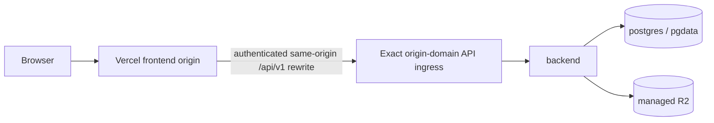
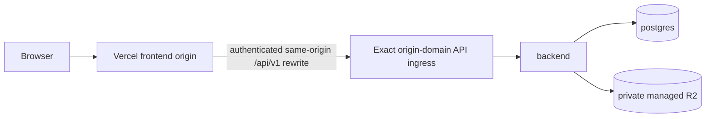

# System Map

[한국어](architecture.md) | **English**

English translation of the [Korean source](architecture.md).
The Korean document remains authoritative.

This document distinguishes the current transition state from the approved target boundaries.
See the [ADR index](decisions/README.en.md) for the rationale behind technical and operational decisions, and [Issue #1113](https://github.com/JNU-SWCU/oss-hub/issues/1113) for R2 implementation progress.

## Planned directory structure

```text
apps/
├── frontend/                 # Next.js user interface
└── backend/                  # NestJS REST API
    └── prisma/               # Prisma schema and migrations
deploy/                       # nginx, Jenkins, and server deployment configuration
compose.yml                   # Production runtime Compose definition
compose.dev.yml               # Development PostgreSQL Compose definition
docs/
├── decisions/                # Architecture Decision Records
├── deploy/                   # Deployment runbooks and manual operating procedures
└── rules/                    # Implementation rules
```

## Component boundaries

- `apps/frontend` owns the browser UI and screen-specific state, and makes API calls through a single client.
- `apps/backend` owns the `/api/v1` REST API, DTO validation, business rules, and persistence access.
- Only the backend accesses PostgreSQL directly.
- See the [model ownership inventory (Korean)](backend-model-ownership.md) for backend model grain, read/write boundaries, and retention boundaries.
- `deploy/` and the Compose files own runtime networking, proxies, and deployment automation.
- `docs/decisions` owns long-term decisions, while `docs/deploy` owns deployment runbooks and repeatable manual operating procedures.

## Current transition state

Checkpoints A and B, cleanup, and G006 custom-domain hardening are complete.
The purchased canonical HTTPS custom domain is the only browser origin, and the backend `FRONTEND_URL` and GitHub OAuth callback use that same origin.
For `/api/v1` requests, Vercel removes the browser's `Authorization` header, injects the production sensitive credential, and rewrites the request to the exact origin domain; origin nginx accepts only authenticated API requests.
Production storage uses private managed R2, while AWS provides only the backend, PostgreSQL, and API-only Compose ingress.
There is no object-storage service, legacy frontend runtime, public IP certificate, or public Jenkins trigger.
[Issue #1113](https://github.com/JNU-SWCU/oss-hub/issues/1113) is the authoritative record of the live cutover receipt.



## Security boundaries

- The browser uses only the canonical custom domain.
  The origin domain and infrastructure addresses are not browser origins, OAuth callbacks, or cookie domains.
- Only the Vercel routing layer holds the production origin credential.
  `Authorization` headers sent by preview deployments or browsers cannot authenticate to the origin.
- Origin nginx uses the client header overwritten by Vercel as the rate-limit key and removes the origin credential and provider headers before forwarding requests to the backend.
- Host nginx's default HTTP/HTTPS servers reject unknown Hosts and expose only `/api/v1/` on the exact origin domain.
  Compose nginx also returns 404 for any Host other than the canonical or loopback Host.
- Jenkins uses only an outbound convergence schedule that runs every 10 minutes and manual execution over the tailnet.
  There is no public build trigger or GitHub deployment token.
- These boundaries eliminate a single rate-limit bucket for all traffic from the proxy peer, Host spoofing, direct-origin browser access, public Jenkins triggers, and legacy IP certificates.



The only production backend storage mode is the exact value `managed`.
It uses the `SUBMISSION_FILE_S3_*` settings, and the credential pair is injected only through Jenkins masked bindings.
The object-storage substitute for local development is owned separately by `compose.dev.yml` and is not part of the production contract.

## Core flows

### Request path

1. Browser UI requests arrive at the Vercel frontend origin.
2. The browser's `/api/v1` requests pass through a Vercel same-origin rewrite to the AWS API ingress and backend.
   The browser does not call the AWS API origin directly.
3. The backend processes requests according to the `/api/v1` API contract and accesses PostgreSQL.
4. Submission files are stored in private managed R2.
5. Responses return to the same browser origin through the AWS API ingress and Vercel rewrite.

### Deployment path

1. GitHub Actions `ci` is solely responsible for quality checks on PRs and merges to main.
   Jenkins does not run for these events, so a merge alone does not change production.
2. Jenkins runs only when a GitHub Release that is neither a draft nor a prerelease is published; publishing that release is itself the deployment authorization.
3. Jenkins verifies the latest full Release and the tag's main ancestry, then checks out the exact commit SHA.
4. An identical or older Release finishes as a no-op.
   A new Release deploys in this order: database backup → configured-endpoint object backup → build → migration → rollout.
5. SDK object backups fail closed if they cannot read and verify the configured endpoint and bucket.
   R2 durability does not replace backups.
6. An application rollback runs only when the captured previous backend image ID, version, and revision all match exactly.
   There is no path for reverting the production storage mode.
