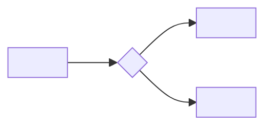
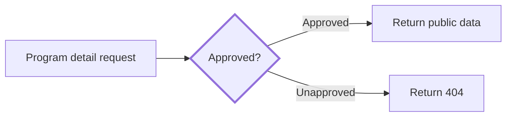
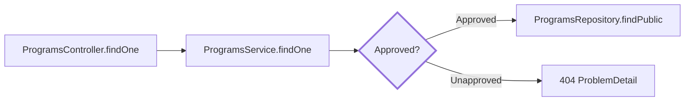

# Include Backend Flow Diagrams in PRs

[한국어](backend-diagram.md) | **English**

English translation of the [Korean source](backend-diagram.md).
The Korean document remains authoritative.

When backend logic changes, show the change in a diagram rather than relying on prose: reviewers cannot easily reconstruct branches and call order from a diff alone.

## Changes requiring a diagram

- Added or removed branches.
- Changed state transitions.
- Changed authorization paths.
- Changed retry/failure handling for asynchronous work.
- Changed call order.
- Moves across Controller → Service → Repository boundaries.

## Changes not requiring one

- Renaming.
- Type-only changes.
- Formatting.
- Test-only changes.
- Log wording changes.

## Format — high level first

A reviewer should be able to identify where this PR changes the flow within ten seconds of seeing the first diagram.
Always use two levels.

1. **First diagram (always visible):** entry → decision → result. No more than eight nodes, one diagram per changed flow. Name nodes by what happens, not class/method identifiers (for example, “Program detail request” rather than `ProgramsController.findOne`).
2. **Detailed diagram (inside `<details>`):** show fields, guards, and call order with actual class/method names. Only readers who need it expand it.

````markdown


<details><summary>Details</summary>

```mermaid
<Fields, guards, and call order using actual class/method names>
```

</details>
````

Default to a Mermaid code block, which GitHub renders natively.

- Call flow: ` ```mermaid ` with `flowchart`.
- State transitions: ` ```mermaid ` with `stateDiagram-v2`.
- Architecture changes (module/boundary moves): a component diagram under the same two-level limits (boxes = modules, arrows = calls).

Use ` ```dot ` (Graphviz) only for structures Mermaid cannot express.
GitHub does not render DOT; include both the source block and a rendered PNG attached to the PR body through GitHub's web editor.
Source alone does not let a reviewer see the diagram.

## Content rules

- If flow changes, show Before and After side by side in the first diagram, or emphasize changed edges with `-.->` and `style ... stroke-width` in one diagram.
- Use plain-language names in the first diagram and actual class/method names in the detailed diagram. Do not invent identifiers.
- Do not put real data, secrets, or personal values in nodes; the [public-safety checker](../../../scripts/check-public-safe.sh) deny-list applies here too.
- Below the diagram, explain what changed and why in one to three lines.

## Example

Move an approval check from `ProgramsController` to `ProgramsService` and reject unapproved requests before querying.



<details><summary>Details</summary>



</details>

Moving the approval branch from Controller to Service allows the same check to be reused from other entry points.
Unapproved requests are rejected before Repository access, so private rows are never queried.

## Where to put it

Use the exact `## 흐름 다이어그램` (Flow diagram) section in the PR body.
The PR template already supplies this heading.
